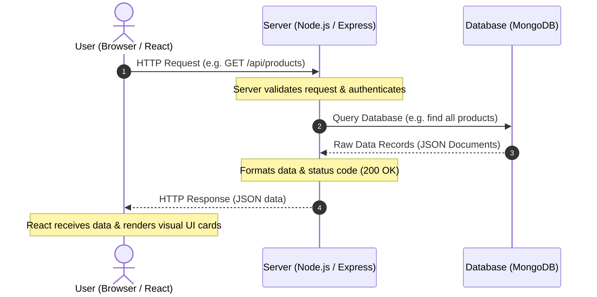

# Lesson 01: How the Web Works & The AI-Native Setup

## ⏱️ Class Agenda (90 Minutes)
* **00:00 - 00:25:** The Restaurant Metaphor (Client, Server, Database mental model).
* **00:25 - 00:45:** The Modern AI Toolkit (VS Code / Cursor / Terminal / Node.js check).
* **00:45 - 01:15:** The "System Architect" Mindset: How to talk to AI like an engineer.
* **01:15 - 01:30:** Live Exercise: Create first project workspace and verify setup.

---

## 💡 What We Teach & Why (The Concept)
Absolute beginners often think "coding" means typing thousands of arcane symbols from memory. We debunk this in minute one. 
In the modern world:
1. **The Browser (Client):** The customer sitting at a table looking at a menu (HTML/CSS/React).
2. **The API / Server (Node/Express):** The waiter taking the customer's order, bringing it to the kitchen, and bringing back food.
3. **The Database (MongoDB):** The kitchen pantry storing ingredients and recipes.

The student's job is **not** to build every plate from scratch with a hammer and chisel. Their job is to be the **Restaurant Manager**: knowing what ingredients belong in the pantry, what orders the waiter takes, and what the customer sees on the table.

---

## 🏛️ Mermaid Diagram: The Core Triad
*(You can paste this directly into Excalidraw, Mermaid Live, or render in Markdown)*



---

## 📁 Where Things Live: Today's Focus
```
my-workspace/
├── .gitignore              <-- Tells Git what NOT to upload
└── package.json            <-- The ID Card of any Node/JS project (lists libraries)
```

---

## 🤖 AI Prompt Recipe for Today
Students test this in their AI tool to verify their environment:
```markdown
I am an absolute beginner setting up my computer for modern web development.
I have a [Mac / Windows] computer.
Please give me 3 terminal commands to check if I have:
1. Node.js installed
2. npm installed
3. Git installed
And explain what each output means in one sentence.
```

---

---

## 📖 Glossary of Critical Terminologies (The Beginner Dictionary)

| Term | Plain-English Definition & Real-World Analogy |
| :--- | :--- |
| **Client (Frontend)** | The part of a website the user directly sees, touches, and interacts with in their web browser (HTML, CSS, JavaScript, React). Analogy: The dining room of a restaurant. |
| **Server (Backend)** | A computer running software (like Node.js & Express) that listens for requests over the internet, enforces security rules, and processes data. Analogy: The kitchen and waitstaff. |
| **Database** | A dedicated storage vault (like MongoDB) designed to store, organize, and retrieve persistent records safely. Analogy: The restaurant pantry and walk-in freezer. |
| **HTTP Request** | A formal digital message sent from the Client to the Server asking to fetch or change data (e.g. "Please send me the menu"). |
| **HTTP Response** | The reply sent back from the Server to the Client containing a status code (like 200 OK) and usually data in JSON format. |
| **Terminal / CLI** | Command Line Interface: A direct text-based conversation with your computer operating system where you type commands instead of clicking icons. |
| **Node.js** | A runtime engine that allows JavaScript to run directly on your computer or server, outside of a web browser. |
| **npm (Node Package Manager)** | The world's largest registry of free, pre-written code packages and tools that you can install in one command (like express or mongoose). |
| **Git & GitHub** | Git is a time-machine tool that tracks code history and changes. GitHub is a cloud platform where you store and share your Git repositories. |

---

## 🎯 The Non-Negotiable Key Takeaways
At the end of this class, every single student **MUST** be able to answer:
1. **What is the difference between a Client, a Server, and a Database?**
   - *Answer:* Client is what the user sees/clicks. Server handles logic and security. Database stores persistent information.
2. **Why can't you connect React directly to MongoDB?**
   - *Answer:* Because anyone can inspect browser code! Putting database credentials in the browser exposes your entire database to hackers. The Server acts as the secure guard.
3. **What is the Terminal?**
   - *Answer:* A direct text conversation with your computer to run servers, install packages, and manage files.
