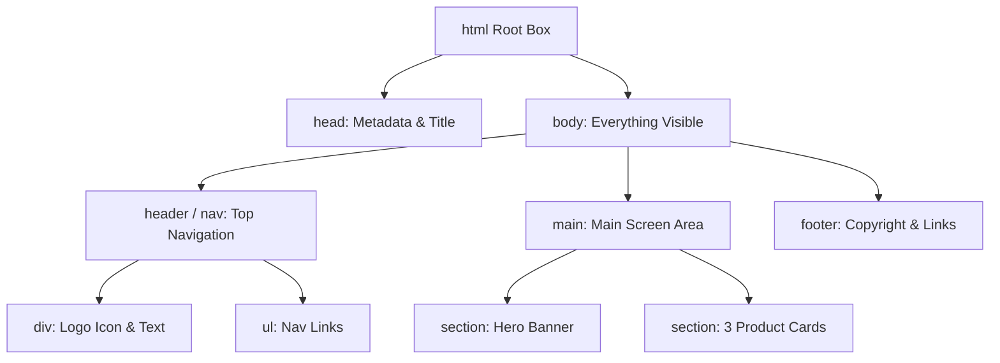

# Lesson 02: Visual Anatomy of a Webpage (HTML, CSS & Blueprinting)

## ⏱️ Class Agenda (90 Minutes)
* **00:00 - 00:25:** The "Everything is a Box" principle (DOM Tree & The Box Model).
* **00:25 - 00:50:** Semantic HTML & Layouts (Headers, Sections, Forms, Buttons).
* **00:50 - 01:15:** Directing AI for CSS & Layouts (Flexbox, Grid, Colors, Responsive design).
* **01:15 - 01:30:** Live Exercise: Turn a rough wireframe into clean HTML/CSS with AI.

---

## 💡 What We Teach & Why (The Concept)
New students often get intimidated by complex CSS rules. We simplify this into one mental rule:
> **Every single website on Earth is just a nested stack of boxes.**

You do not need to memorize 400 CSS properties. You only need to know:
1. **Container vs Content:** A parent box holds child boxes.
2. **The Box Model:** Margin (space outside) ➔ Border (the frame) ➔ Padding (space inside) ➔ Content.
3. **Flexbox:** Aligning boxes horizontally or vertically.

When pairing with AI, if a student can describe the boxes (`"A horizontal navbar with a logo on the left and 3 links on the right"`), the AI will generate the exact CSS instantly.

---

## 🏛️ Mermaid Diagram: The DOM Tree Hierarchy


---

## 📁 Where Things Live: Today's Focus
```
my-landing-page/
├── index.html              <-- Semantic structure (divs, headings, buttons)
├── styles.css              <-- Colors, flexbox layouts, padding, hover animations
└── assets/                 <-- Images, icons, logos
```

---

## 🤖 AI Prompt Recipe for Today
Students practice the "Wireframe Description Prompt":
```markdown
I am creating a modern, sleek landing page hero section.
Generate clean semantic HTML and modern CSS.

Requirements:
- Dark luxury theme (deep slate background #0a0d14, vibrant indigo/cyan accents).
- Layout: 2-column flexbox:
  - Left column: Pill badge ("New Vibe Coding"), high-impact H1 title, subtext paragraph, and 2 CTA buttons ("Get Started" and "View Demo").
  - Right column: A glassmorphic card previewing a mock code editor.
- Make it fully responsive for mobile screens.
- Use Google Font 'Inter'.
Provide HTML and CSS clearly separated.
```

---

---

## 📖 Glossary of Critical Terminologies (The Beginner Dictionary)

| Term | Plain-English Definition & Real-World Analogy |
| :--- | :--- |
| **DOM (Document Object Model)** | The browser's internal family tree representation of all the HTML elements on a webpage, which JavaScript can dynamically read and manipulate. |
| **Semantic HTML** | Using meaningful tags (like <header>, <nav>, <main>, <button>) that clearly describe their purpose to browsers, search engines, and screen readers, rather than just generic <div> tags. |
| **The Box Model** | The fundamental CSS rule that every element is a rectangular box made of 4 layers: Content (text/image), Padding (cushion inside), Border (frame), and Margin (spacing outside). |
| **Flexbox** | A CSS layout tool designed to easily distribute space and align boxes horizontally in a row or vertically in a column with simple commands. |
| **Responsive Design** | Building webpages that automatically adapt, shrink, expand, and reorganize cleanly across desktop monitors, tablets, and mobile phones. |
| **CSS Selectors** | Patterns used to target specific HTML elements for styling (e.g. tag selectors, .class selectors, and #id selectors). |

---

## 🎯 The Non-Negotiable Key Takeaways
At the end of this class, every single student **MUST** be able to answer:
1. **What is the Box Model?**
   - *Answer:* Every element has Content, Padding (cushion inside), Border (outline), and Margin (pushing away neighbors).
2. **What is Flexbox in plain English?**
   - *Answer:* A CSS tool that easily lines up boxes in a row or column and distributes space between them.
3. **Why do we use semantic tags (`<nav>`, `<main>`, `<button>`) instead of just `<div>`?**
   - *Answer:* For accessibility (screen readers), SEO, and because it gives AI and developers a clear understanding of the page structure.
