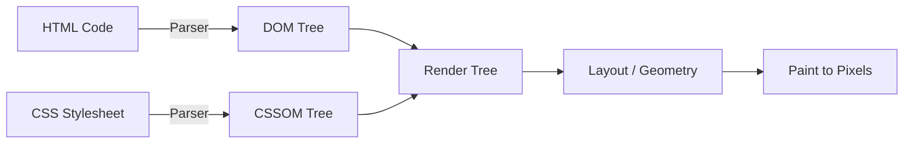
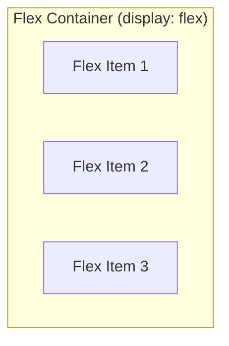
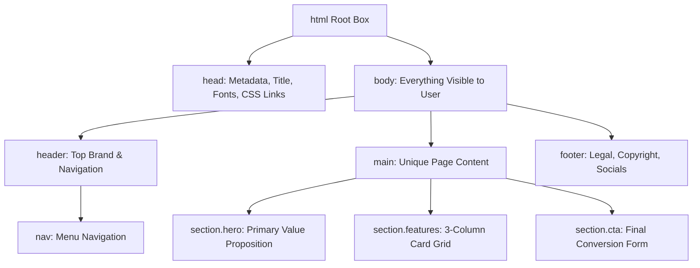

# Lesson 02: Visual Anatomy of a Webpage (HTML, CSS & Blueprinting)

## ⏱️ Class Agenda (90 Minutes)
* **00:00 - 00:20:** The "Everything is a Box" Mental Model (DOM Hierarchy, Document Flow & The Box Model).
* **00:20 - 00:40:** Semantic HTML vs "Div Soup" (Accessibility, SEO, Structure & How AI Reads Code).
* **00:40 - 01:05:** CSS Layouts & Alignment Architecture (Flexbox Deep Dive, Positioning, Sizing & Units).
* **01:05 - 01:20:** Modern Aesthetics & Responsive Blueprinting (Glassmorphism, CSS Variables, Media Queries).
* **01:20 - 01:30:** Live Hands-on Exercise: Convert an ASCII wireframe into modern HTML/CSS with an AI coding partner.

---

## 💡 What We Teach & Why (The Core Concept)

Beginners are frequently overwhelmed when staring at thousands of lines of HTML and CSS. They assume expert web developers memorize hundreds of obscure CSS properties. 

In reality, modern frontend architecture rests on a single foundational mental model:
> **Every single website on Earth is just a nested hierarchy of rectangular boxes.**

Whether you are looking at Apple.com, Netflix, Spotify, or Twitter/X:
1. **HTML defines what boxes exist** (headings, text, images, buttons, navigation bars) and how they nest inside one another.
2. **CSS defines how boxes look, scale, and align** (colors, padding, borders, spacing, and flexbox distribution).
3. **The Browser assembles these boxes into a tree** called the **DOM (Document Object Model)** and paints pixels onto the screen.

When pairing with AI ("Vibe Coding"), your superpower is **Blueprinting**: the ability to look at a design, mentally break it down into parent containers and child elements, and speak the language of the Box Model. If you can clearly articulate:
> *"Create a `<header>` containing a 2-item flexbox row with space-between: on the left a logo, on the right an unordered list of 4 nav links with 1.5rem gap,"*

an AI coding agent will generate pixel-perfect, production-grade code on the very first try.

---

## 🧱 The Mental Models You Must Master

### 1. The Browser Rendering Pipeline (How Code Turns into Pixels)
When your browser downloads an HTML file, it doesn't instantly paint colors:
1. **HTML Parsing ➔ DOM Tree:** The browser reads tags from top to bottom and builds the DOM (the element hierarchy).
2. **CSS Parsing ➔ CSSOM:** The browser reads CSS rules and determines styles for each node.
3. **Render Tree:** The browser matches DOM elements with their CSSOM styles (ignoring hidden elements like `<head>` or `display: none`).
4. **Layout (Reflow):** The browser calculates the exact geometry, width, height, and coordinates of every box on screen.
5. **Painting (Rasterize):** Pixels are drawn to the screen (text, colors, borders, shadows, images).



---

### 2. The Box Model: The 4 Concentric Layers
Every single HTML element on a webpage is wrapped in 4 distinct layers:

```
+-------------------------------------------------------------+
| MARGIN (Transparent space pushing neighboring boxes away)   |
|   +-------------------------------------------------------+ |
|   | BORDER (The visible frame / outline around the box)   | |
|   |   +-------------------------------------------------+ | |
|   |   | PADDING (Inner cushion between content & border)| | |
|   |   |   +-------------------------------------------+ | | |
|   |   |   | CONTENT (The text, image, icon, or video) | | | |
|   |   |   +-------------------------------------------+ | | |
|   |   +-------------------------------------------------+ | |
|   +-------------------------------------------------------+ |
+-------------------------------------------------------------+
```

* **Content:** The actual payload (e.g. `<h1>Hello World</h1>` or an ``).
* **Padding:** Cushion *inside* the box. When you increase padding, the box's background color expands with it.
* **Border:** The decorative border or line surrounding the padding (e.g. `1px solid rgba(255,255,255,0.1)`).
* **Margin:** Empty space *outside* the border that pushes other neighboring elements away. Margins are transparent.

#### ⚠️ The Most Common Beginner Trap: `box-sizing: border-box`
By default, the web browser uses `box-sizing: content-box`. Under this old rule:
$$\text{Total Rendered Width} = \text{width} + \text{left/right padding} + \text{left/right border}$$
If you set a box to `width: 300px` and add `padding: 20px`, the box unexpectedly blows up to **340px**, breaking your grid!

**The Modern Solution:** Every modern stylesheet begins with the universal reset:
```css
*, *::before, *::after {
  box-sizing: border-box;
  margin: 0;
  padding: 0;
}
```
With `border-box`, `width: 300px` means the entire box stays **exactly 300px**. Padding and border shrink inward instead of blowing the element outward.

---

### 3. Block vs. Inline vs. Inline-Block (Visual Anatomy & Behavior)
How elements naturally flow and position themselves on the screen is governed by their `display` property:

#### 🖼️ The Visual Blueprint: How They Flow in the Browser

```
1. BLOCK ELEMENTS (display: block)
   [Demands its own full line; stretches across 100% of parent width]
   +-----------------------------------------------------------------------+
   |  <div class="box-1"> BLOCK 1 (Stretches full width of container)     |
   +-----------------------------------------------------------------------+
   |  <div class="box-2"> BLOCK 2 (Always starts on a brand new line)     |
   +-----------------------------------------------------------------------+
   |  <p> BLOCK 3 (Custom width: 300px, height: 60px — fully respected!)  |
   +-----------------------------------------------------------------------+

2. INLINE ELEMENTS (display: inline)
   [Flows like words in a sentence; tightly wraps only around inner content]
   Here is normal sentence text with <span class="badge">INLINE 1</span> and another
   <a href="#">INLINE 2 (Link)</a> flowing seamlessly side-by-side on the same line!
   ⚠️ Notice: Custom width & height (e.g. width: 200px) are COMPLETELY IGNORED.
   ⚠️ Vertical margins (margin-top/bottom) DO NOT push adjacent lines away.

3. INLINE-BLOCK ELEMENTS (display: inline-block)
   [The Hybrid Superpower: Sits side-by-side like words, BUT keeps full box sizing!]
   Here is text with +--------------------+  +--------------------+
                     | INLINE-BLOCK 1     |  | INLINE-BLOCK 2     |
                     | width: 140px;      |  | width: 140px;      |
                     | height: 45px;      |  | height: 45px;      |
                     +--------------------+  +--------------------+
   all sitting peacefully on the same horizontal line!
```

#### 📊 Quick Comparison Matrix:
| Feature / Rule | Block (`display: block`) | Inline (`display: inline`) | Inline-Block (`display: inline-block`) |
| :--- | :--- | :--- | :--- |
| **Starts on New Line?** | **YES** — Always breaks to a new line before & after | **NO** — Flows horizontally alongside text | **NO** — Sits side-by-side on the same line |
| **Default Width** | **100%** of parent container width | Fits **only** its inner text/content width | Fits its inner text/content width |
| **Custom `width` & `height`?** | **YES** — Fully respected | ❌ **IGNORED** (Has zero visual effect!) | **YES** — Fully respected |
| **Horizontal Spacing?** | **YES** (`margin-left/right`, padding) | **YES** (`margin-left/right`, padding) | **YES** (All horizontal spacing respected) |
| **Vertical Margins (`top`/`bottom`)?** | **YES** — Pushes top and bottom elements away | ❌ **NO** — Does **not** push neighboring lines | **YES** — Pushes surrounding text and boxes |
| **Default HTML Elements** | `<div>`, `<section>`, `<header>`, `<h1>-<h6>`, `<p>`, `<ul>`, `<li>` | `<span>`, `<a>`, `<strong>`, `<em>`, `<code>` | `<button>`, `<input>`, `<select>`, `` |

#### ⚠️ The #1 Beginner Gotcha:
> **The Problem:** You try to give a link `<a>` or badge `<span>` a `width: 150px; height: 50px; margin-top: 20px;`, and **nothing happens**.
> **The Reason:** `<a>` and `<span>` are `inline` by default! Browsers deliberately ignore width, height, and vertical margins on inline tags.
> **The Fix:** Change the display mode: `display: inline-block;` (or `display: flex;` or `display: block;`).


---

### 4. Semantic HTML vs. "Div Soup"
A common bad habit is using generic `<div>` tags for everything. This creates "Div Soup":

```html
<!-- ❌ BAD: "Div Soup" (Unreadable, inaccessible, bad for SEO, confuses AI) -->
<div class="top-bar">
  <div class="links">
    <div class="link">Home</div>
  </div>
</div>
<div class="big-box">
  <div class="button-thing">Click Me</div>
</div>
```

```html
<!-- ✅ GOOD: Semantic HTML (Clean, accessible, SEO-optimized, crystal clear for AI) -->
<header>
  <nav>
    <ul>
      <li><a href="#home">Home</a></li>
    </ul>
  </nav>
</header>
<main>
  <section class="hero">
    <button type="button">Click Me</button>
  </section>
</main>
```

#### Why Semantic HTML is Crucial:
1. **Accessibility (a11y):** Screen readers use tags like `<nav>`, `<main>`, and `<button>` to let visually impaired users navigate your site via keyboard.
2. **SEO (Search Engine Optimization):** Google crawlers use `<header>`, `<h1>`, and `<article>` to rank your content relevance.
3. **AI Pair Programming:** When you ask AI to refactor code, semantic structure provides clear architectural anchors rather than 50 nested anonymous `<div>` tags.

---

### 5. Flexbox: The 1D Layout Engine
Flexbox arranges boxes along a single dimension: either horizontally in a **row** or vertically in a **column**.



#### The Golden Flexbox Properties:
```css
.parent-container {
  display: flex;                  /* Activates flexbox */
  flex-direction: row;           /* row (horizontal) or column (vertical) */
  justify-content: space-between;/* Main-axis alignment: flex-start | center | flex-end | space-between | space-evenly */
  align-items: center;           /* Cross-axis alignment: stretch | center | flex-start | flex-end */
  gap: 1.5rem;                   /* Modern space between items (replaces hacky margins!) */
  flex-wrap: wrap;               /* Lets items wrap to the next line on mobile */
}

.child-box {
  flex: 1;                       /* Tells this item to grow and fill available remaining space */
}
```

---

### 6. CSS Positioning (`position`)
Controls how an element is placed relative to the normal document flow:

* **`static` (Default):** Normal document flow. Elements stack one after another.
* **`relative`:** Stays in normal flow, but allows subtle offsets (`top`, `left`) AND acts as an anchor boundary for `absolute` children.
* **`absolute`:** Removed from normal document flow. Hovers in space positioned relative to the nearest ancestor with `position: relative`.
* **`fixed`:** Removed from document flow and pinned directly to the browser window/viewport (stays in place as the user scrolls, e.g. floating navbar or chat bubble).
* **`sticky`:** Scrolls naturally until it hits a specified scroll threshold (e.g. `top: 0`), then "sticks" like a fixed element until its parent container ends.
* **`z-index`:** The 3D stacking order. Higher numbers sit on top of lower numbers (e.g. `z-index: 100` sits above `z-index: 10`).

---

## 🏛️ Architecture Blueprint: Semantic Page Layout



---

## 📁 File Structure: Where Visual Code Lives
```
my-landing-page/
├── index.html              <-- Semantic structure (tags, headings, forms, buttons)
├── styles.css              <-- Visual design system (colors, fonts, box model, flexbox)
└── assets/                 <-- Static media files
    ├── logo.svg            <-- Vector brand icon
    └── hero-preview.png    <-- High-res interface mockup
```

---

## 📖 Complete Glossary of Critical Terminologies

Every single technical term in Lesson 02 defined with plain-English meaning, real-world analogies, and relevance to modern development:

### 🌐 Group 1: HTML & Document Structure Terms

| Term | Plain-English Definition | Real-World Analogy | Code / Syntax Example | Why It Matters for Vibe Coding |
| :--- | :--- | :--- | :--- | :--- |
| **HTML (HyperText Markup Language)** | The standard markup code that defines the structural skeleton and contents of a web page using tags. | The framing studs, drywall, and structural walls of an unfurnished house. | `<!DOCTYPE html><html lang="en">...</html>` | HTML is the foundation. Without clean HTML structure, styling with CSS and interactivity with JS collapse. |
| **HTML Element** | A complete individual unit on a webpage, typically consisting of an opening tag, attributes, text content, and a closing tag. | A single piece of furniture, like a labeled drawer or bookshelf. | `<button class="btn">Submit</button>` | AI generates elements based on your blueprint. Elements are the nodes of the DOM tree. |
| **HTML Tag** | The bracketed keywords (`<tag>` and `</tag>`) that tell the browser what type of element is being defined. | Bookends holding the content together. | `<header>`, `</header>`, `<p>`, `</p>` | Mismatched or unclosed tags break the entire layout hierarchy. |
| **Void / Self-Closing Tag** | An HTML element that cannot hold inner text content or child elements, so it does not require a separate closing tag. | A sticker or picture frame that doesn't open up. | ``, `<input type="text" />`, `<br />`, `<hr />` | Avoids syntax errors. You never write `</img>` or `<input></input>`. |
| **HTML Attribute** | Special configuration keywords placed inside the opening tag to provide metadata, styling hooks, or behavior. | The settings panel or luggage tag on a suitcase. | `id="navbar"`, `class="card active"`, `href="/about"`, `src="pic.png"` | Attributes like `class` and `id` allow CSS and JS to find and style specific boxes. |
| **DOM (Document Object Model)** | The live, in-memory tree representation of all HTML elements created by the browser when loading a page. | The computerized architectural blueprint of a building that can be inspected and updated in real time. | In browser console: `document.querySelector('h1').innerText` | JavaScript modifies the page by reading and altering the DOM. |
| **DOM Tree Hierarchy (Parent, Child, Sibling)** | The genealogical relationship between nested tags. An outer box is the **Parent**, inner tags are **Children**, and tags sharing the same parent are **Siblings**. | Russian nesting dolls or a family tree. | `<nav>` (parent) contains `<ul>` (child); two `<li>` inside `<ul>` are siblings. | Crucial for Flexbox and CSS combinators. Flexbox properties on a parent only affect direct children! |
| **Semantic HTML** | Writing HTML using tags that convey the human- and machine-readable meaning of the content (`<header>`, `<nav>`, `<article>`) rather than generic `<div>` tags. | Labeling kitchen jars "Sugar", "Flour", and "Salt" instead of "Jar 1", "Jar 2", and "Jar 3". | `<nav>`, `<main>`, `<section>`, `<article>`, `<aside>`, `<footer>`, `<figure>` | Improves Google SEO, enables accessibility for screen readers, and helps AI parse your code accurately. |
| **"Div Soup"** | An anti-pattern where a developer uses dozens of nested, meaningless `<div>` tags for every single element on the page. | A book with no chapter titles, paragraphs, or headings—just one giant wall of identical text blocks. | `<div><div><div><div>Click</div></div></div></div>` | Makes code unmaintainable and confuses AI assistants trying to refactor components. |
| **Block-Level Element** | An HTML element that automatically takes up the entire available width of its container and forces subsequent content onto a new line. | A brick in a wall—it occupies its own full horizontal tier. | `<div>`, `<h1>-<h6>`, `<p>`, `<section>`, `<ul>`, `<li>` | Used for structuring major content sections and vertical stacks. |
| **Inline Element** | An HTML element that only occupies the exact width of its content and flows horizontally alongside neighboring text without creating a line break. | A highlighted word inside a printed sentence. | `<span>`, `<a>`, `<strong>`, `<em>`, `<code>` | Used for formatting inline text or links without disrupting paragraph flow. |
| **Inline-Block Element** | A hybrid element that flows horizontally like inline text, but respects custom width, height, padding, and margins like a block element. | An icon badge or button placed right inside a paragraph. | `<button>`, `<input>`, or CSS `display: inline-block` | The foundation for styling buttons, badges, and form controls. |
| **Viewport & Viewport Meta Tag** | The visible rectangle of the screen where web content is rendered. The meta tag ensures mobile browsers render at device width rather than zooming out. | The physical window pane through which you look outside. | `<meta name="viewport" content="width=device-width, initial-scale=1.0">` | Mandatory for every mobile-friendly responsive website. Without it, mobile phones render desktop-sized pages at 25% scale. |

---

### 🎨 Group 2: CSS Sizing & Box Model Terms

| Term | Plain-English Definition | Real-World Analogy | Code / Syntax Example | Why It Matters for Vibe Coding |
| :--- | :--- | :--- | :--- | :--- |
| **CSS (Cascading Style Sheets)** | The style sheet language used to specify the presentation, layout, colors, typography, and visual effects of HTML documents. | The paint, interior decorating, lighting, and styling of a house. | `body { background: #0a0d14; color: #fff; }` | Separates visual presentation from HTML content structure. |
| **The Box Model** | The fundamental CSS rule stating that every single visible element on a web page is enclosed in 4 concentric boxes: Content, Padding, Border, Margin. | An Amazon parcel: Item (Content), Bubble wrap (Padding), Cardboard box (Border), and Space in delivery truck (Margin). | Standard CSS box rendering. | Master this model and 90% of styling bugs vanish instantly. |
| **Content** | The innermost area of the Box Model where actual text, images, or child elements reside. | The gift inside the wrapped box. | `width: 300px; height: 200px;` | Determines the core payload dimensions. |
| **Padding** | The interior clearance space between the element's content and its border. Background colors extend into padding. | Bubble wrap or foam cushioning packed inside a shipping box. | `padding: 1rem 1.5rem;` (top/bottom, left/right) | Gives buttons and cards breathing room so text doesn't touch the edges. |
| **Border** | The outline or boundary line wrapping around the padding and content. | The wooden or metal frame around a hanging painting. | `border: 1px solid rgba(255,255,255,0.1); border-radius: 8px;` | Defines distinct boundaries, card edges, and luxury glassmorphic outlines. |
| **Margin** | The transparent buffer space *outside* the border that pushes adjacent elements away. | Personal space between passengers sitting on a subway bench. | `margin: 0 auto;` (centers a box horizontally) | Prevents elements from colliding and creates consistent layout rhythm. |
| **Margin Collapse** | A CSS behavior where the vertical (top/bottom) margins of two adjoining block elements combine into a single margin equal to the largest of the two, rather than adding together. | Two overlapping bubbles that merge into one bubble rather than stacking. | Box 1 has `margin-bottom: 30px`; Box 2 has `margin-top: 20px`. The gap between them is **30px**, not 50px! | Solves the mystery of "Why didn't my margins add up?" Modern Flexbox `gap` avoids this issue completely. |
| **`box-sizing: border-box`** | A CSS property that forces `width` and `height` to include content, padding, and border within the stated measurement. | A fixed suitcase where packing more items compresses inside rather than enlarging the suitcase exterior. | `* { box-sizing: border-box; }` | **The #1 CSS golden rule.** Prevents layout breakage when padding or borders are added to cards. |
| **`box-sizing: content-box`** | The outdated browser default where padding and borders are added *on top* of the declared width, making elements unexpectedly wider. | A suitcase that physically expands and rips every time you add bubble wrap. | Browser default setting. | Legacy quirk; always override it with `border-box`. |
| **Absolute Units (`px`)** | Fixed physical measurement units (pixels) that do not scale relative to screen settings or user font preferences. | A rigid wooden ruler with millimeter ticks. | `font-size: 16px; border: 2px solid #fff;` | Good for thin borders and fixed shadows; bad for accessible typography. |
| **Relative Units (`rem`, `em`, `%`, `vw`, `vh`)** | Dynamic measurement units that scale relative to root font size (`rem`), parent size (`em`, `%`), or screen dimensions (`vw`, `vh`). | A rubber band that stretches proportionally to the size of the room. | `font-size: 1.25rem; width: 50%; height: 100vh;` | Essential for modern responsive design and accessibility when users zoom. |

---

### 📐 Group 3: CSS Layout & Flexbox Terms

| Term | Plain-English Definition | Real-World Analogy | Code / Syntax Example | Why It Matters for Vibe Coding |
| :--- | :--- | :--- | :--- | :--- |
| **`display` Property** | The CSS property that determines the rendering box type of an element and how its inner children are laid out. | Flipping a machine from "conveyor belt" mode to "grid" mode. | `display: block | inline | flex | grid | none;` | Changing `display` fundamentally alters how an element behaves on screen. |
| **Flexbox (Flexible Box Layout)** | A CSS 1-dimensional layout module engineered to distribute space and align items along a row or column automatically. | An elastic clothesline where shirts automatically space themselves evenly. | `display: flex;` | Used for 95% of modern web components: navbars, button rows, card headers. |
| **Flex Container** | The parent element that has `display: flex` applied to it, establishing a flex formatting context for its direct children. | The supervisor box managing the arrangement of its workers. | `<div class="navbar" style="display: flex;">` | Flex properties (`justify-content`, `align-items`) must be placed on the container, not the children! |
| **Flex Items** | The direct child elements sitting immediately inside a Flex Container. | The books lined up on a single shelf. | Direct children of `<div style="display: flex;">` | Flex items gain superpowers like automatic height equalization and flexible growth. |
| **Main Axis & Cross Axis** | The primary direction of item flow (Main Axis) and its perpendicular direction (Cross Axis). If `flex-direction: row`, Main is horizontal and Cross is vertical. | The highway lanes (Main Axis) vs the exit ramps crossing over (Cross Axis). | `flex-direction: row;` (Main: horizontal) vs `flex-direction: column;` (Main: vertical) | You must know which axis is which to pick between `justify-content` and `align-items`. |
| **`justify-content`** | Aligns flex items along the **Main Axis** (distributing horizontal space in rows, or vertical space in columns). | Spreading passengers evenly along a bench. | `justify-content: space-between;` | Powers standard navbar layouts (logo on far left, nav links on far right). |
| **`align-items`** | Aligns flex items along the **Cross Axis** (distributing vertical space in a row). | Aligning picture frames by their centers or tops on a wall. | `align-items: center;` | The universal trick to vertically center text, icons, and buttons inside a container. |
| **`gap`** | Defines the clean spacing between grid or flex items without requiring hacky margins on individual children. | The uniform space between seats in a movie theater. | `gap: 1.5rem;` or `gap: 20px 10px;` | Eliminates old-school `:last-child { margin-right: 0 }` workarounds. |
| **`flex-wrap`** | Determines whether flex items are forced to stay on a single line or allowed to wrap onto multiple lines when space runs out. | Text automatically wrapping to the next line when typing near the right margin. | `flex-wrap: wrap;` | Prevents cards from squishing or overflowing off-screen on mobile devices. |
| **`flex: 1` (`flex-grow`, `flex-shrink`, `flex-basis`)** | Shorthand rule telling a flex item to expand and occupy all remaining available space in its parent container. | An expandable accordion folder that stretches to fill empty briefcase space. | `flex: 1;` or `flex: 0 0 300px;` | Crucial for two-column layouts where one sidebar is fixed and the main content expands. |
| **CSS Grid** | A 2-dimensional layout system that allows placing elements into both rows AND columns simultaneously. | A chessboard or spreadsheet with explicit grid coordinates. | `display: grid; grid-template-columns: repeat(3, 1fr); gap: 1rem;` | Ideal for photo galleries, dashboard widget layouts, and multi-column card catalogs. |
| **CSS Positioning (`position`)** | Specifies how an element is positioned in the document: `static`, `relative`, `absolute`, `fixed`, or `sticky`. | Deciding whether an object sits on the floor, pins to the ceiling, or hovers in mid-air. | `position: relative;`, `position: absolute;` | Allows creating overlay badges, modal popups, and sticky top headers. |
| **`z-index`** | Controls the 3-dimensional stacking order of elements that overlap along the z-axis (depth). | Stacking playing cards on top of one another on a table. | `z-index: 1000;` (modal overlay), `z-index: 10;` (navbar) | Higher values appear in front of lower values. Only works on positioned elements (`relative`, `absolute`, `fixed`). |

---

### 🎯 Group 4: CSS Selectors, Cascade & Specificity Terms

| Term | Plain-English Definition | Real-World Analogy | Code / Syntax Example | Why It Matters for Vibe Coding |
| :--- | :--- | :--- | :--- | :--- |
| **CSS Ruleset** | A complete block of styling code made of a Selector and a Declaration block containing Property-Value pairs. | A command order: *"Target this person (Selector), and make their jacket blue (Property: Value)"*. | `h1 { color: #6366f1; font-size: 2rem; }` | The fundamental syntax unit of all CSS stylesheets. |
| **The Cascade & Specificity** | The algorithm browsers use to resolve conflicts when multiple CSS rules target the same element (Inline styles > IDs > Classes > Tags). | A hierarchy of authority: The CEO's direct order overrides the department manager's general rule. | `#hero` (Score 100) beats `.banner` (Score 10) beats `div` (Score 1). | Explains why a style might not be applying—another rule with higher specificity is overriding it! |
| **Class Selector (`.`)** | A selector prefixed with a dot (`.`) that targets any element bearing that specific class name. Can be reused on infinite elements. | A uniform worn by any team member (e.g. all medical staff wearing scrubs). | `.btn { border-radius: 6px; }` | **The gold standard for styling.** 90% of styling should use reusable class names. |
| **ID Selector (`#`)** | A selector prefixed with a hash (`#`) that targets a single unique element with that exact ID. | A person's unique Passport number or Social Security number. | `#main-header { height: 70px; }` | IDs should be unique per page. Avoid overusing for styling due to overly aggressive specificity. |
| **Attribute Selector** | Targets elements based on the presence or exact value of an HTML attribute inside brackets `[ ]`. | Searching an employee database for everyone whose job title equals "Manager". | `input[type="password"] { border-color: red; }` | Perfect for styling specific form inputs without polluting HTML with extra classes. |
| **Pseudo-Class (`:`)** | A keyword added to a selector that targets an element only when it is in a specific interactive or structural state. | A chameleon changing color only when touched or under sunlight. | `button:hover { background: #4f46e5; }`, `input:focus`, `li:nth-child(2)` | Powers interactive hover effects, active button clicks, and alternating table rows. |
| **Pseudo-Element (`::`)** | A keyword added to a selector that styles a specific sub-part of an element or injects decorative visual content via CSS. | Adding decorative trim or a shadow behind an existing picture frame. | `p::first-line`, `.card::before { content: ""; ... }` | Used for glowing background glows, decorative tooltips, and badges without extra HTML tags. |
| **CSS Variables (Custom Properties)** | Centrally declared tokens prefixed with `--` that store reusable values (colors, fonts, spacing) throughout a stylesheet. | Defining a master brand color palette once, so changing one value updates the entire company website. | `:root { --accent-cyan: #06b6d4; }` <br> `h1 { color: var(--accent-cyan); }` | Enables effortless dark mode switching and consistent design system tokens across projects. |

---

### 📱 Group 5: Responsive Design & Modern UI Terms

| Term | Plain-English Definition | Real-World Analogy | Code / Syntax Example | Why It Matters for Vibe Coding |
| :--- | :--- | :--- | :--- | :--- |
| **Responsive Web Design (RWD)** | Designing web pages that dynamically adapt and reflow their layout smoothly across any screen size (mobile, tablet, desktop). | Water poured into a glass becomes the glass; water poured into a teapot becomes the teapot. | Fluid percentages, Flexbox wrapping, Media queries. | Over 60% of all global web traffic is mobile. A site that looks broken on mobile is unusable. |
| **Media Query (`@media`)** | A CSS block that only applies styles if the user's device matches specified condition rules (like maximum screen width). | A wardrobe rule: *"If the temperature is below 50°F, put on a heavy winter coat."* | `@media (max-width: 768px) { .nav-links { display: none; } }` | The engine of responsive design. Reorganizes multi-column desktop grids into single vertical mobile stacks. |
| **Breakpoint** | The specific screen pixel width where a webpage's layout shifts to accommodate smaller or larger screens (e.g. 640px, 768px, 1024px, 1280px). | The point at which an airline passenger switches from a small backpack to checking in a large suitcase. | Common breakpoints: `640px` (mobile), `768px` (tablet), `1024px` (laptop). | Prevents ugly horizontal scrollbars and squished cards on intermediate device sizes. |
| **Mobile-First Design** | Designing CSS styles for the smallest mobile screen first, then progressively adding complexity for larger screens using `@media (min-width)`. | Packing the essential survival items in a small pouch before packing luxury items into a large trunk. | `/* Mobile styles first */` <br> `@media (min-width: 768px) { /* Tablet/Desktop */ }` | Produces faster-loading, cleaner, and more resilient responsive CSS. |
| **Glassmorphism** | A modern UI design trend featuring translucent frosted-glass backgrounds with subtle borders and blurred content behind. | Looking through a frosted shower door or iced window pane. | `background: rgba(22, 30, 46, 0.7); backdrop-filter: blur(16px); border: 1px solid rgba(255,255,255,0.08);` | Creates a premium, high-tech, futuristic aesthetic (as seen in macOS, iOS, and Linear). |
| **CSS Transitions & Transforms** | CSS properties that smoothly animate changes between states (e.g. hover scale, color fade) without requiring heavy JavaScript. | A dimmer switch smoothly fading room lights up instead of an abrupt click. | `transition: all 0.2s ease-in-out;` <br> `button:hover { transform: translateY(-2px); }` | Provides tactile feedback and polished micro-interactions that make websites feel responsive and alive. |
| **Wireframing / Blueprinting** | The architectural planning stage where a layout is mapped into nested containers and components before writing actual code. | An architect drawing blueprints before bricklayers start pouring concrete. | Sketching: Header (Logo + Nav) ➔ Hero (2 Columns) ➔ Footer. | The core skill of Vibe Coding: accurate blueprints yield flawless AI code generation. |

---

## 🤖 AI Prompt Recipe for Today

### The "Visual Blueprinting" Prompt Template
When prompting an AI (in Cursor, Claude, or ChatGPT) to build a component or page, use this proven architectural recipe:

```markdown
I am building a modern, high-converting hero section for a developer tool.
Act as an expert frontend engineer. Generate clean semantic HTML and modern CSS.

Design Blueprint:
1. Palette: Dark luxury theme
   - Background: #0a0d14
   - Card Background: rgba(22, 30, 46, 0.7) with backdrop-filter blur (glassmorphism)
   - Accent colors: Electric Indigo (#6366f1) and Neon Cyan (#06b6d4)
   - Typography: Google Font 'Inter' with 'Outfit' for headings
2. Layout Structure:
   - Root container: Centered, max-width 1200px, 2-column Flexbox layout with align-items center and 2rem gap.
   - Left Column (flex: 1):
     - Pill badge: "✨ Next-Gen Vibe Coding" (subtle border, glowing text)
     - Heading: H1 with bold gradient text
     - Subtext: Muted slate paragraph with 1.6 line-height
     - Action Row: Flex container with 2 buttons:
       - Primary: Indigo gradient with hover elevation (translateY -2px)
       - Secondary: Ghost button with translucent border
   - Right Column (flex: 1):
     - Glassmorphic card displaying a mock code editor window with 3 colored mac window dots (red, yellow, green) and syntax-highlighted code.
3. Responsiveness:
   - On screens smaller than 768px (@media max-width: 768px), collapse the flex direction to column (stacking left column on top of right).
   - Ensure box-sizing: border-box is applied universally.

Provide the HTML and CSS clearly separated with descriptive comments explaining the box model and flexbox alignment choices.
```

---

## 🎯 The Non-Negotiable Key Takeaways

At the end of this class, every single student **MUST** be able to answer these core questions without hesitation:

1. **What is the Box Model, and what are its 4 layers from inside out?**
   - *Answer:* Every element is a rectangular box made of: **Content** (text/media) ➔ **Padding** (interior cushion) ➔ **Border** (the visible frame) ➔ **Margin** (exterior buffer pushing neighbors away).

2. **Why do professional developers always set `box-sizing: border-box` on all elements?**
   - *Answer:* Under the default `content-box`, adding padding or borders enlarges the element beyond its specified `width`, breaking layouts. `border-box` forces padding and borders to fit *inside* the declared width.

3. **What is the difference between Margin and Padding in one sentence?**
   - *Answer:* **Padding** creates space *inside* the element's border (expanding the colored background); **Margin** pushes *outside* the border away from neighboring elements.

4. **Why is Flexbox called a "1-Dimensional" layout system?**
   - *Answer:* Because Flexbox arranges items along a single axis at a time—either in a horizontal row (`flex-direction: row`) or a vertical column (`flex-direction: column`).

5. **What is the difference between `justify-content` and `align-items`?**
   - *Answer:* `justify-content` aligns items along the **Main Axis** (flow direction); `align-items` aligns items along the perpendicular **Cross Axis**.

6. **Why shouldn't you build an entire website out of generic `<div>` tags?**
   - *Answer:* "Div Soup" harms accessibility for screen reader users, destroys SEO rankings on Google, and deprives AI assistants and developers of structural meaning. Semantic tags (`<header>`, `<nav>`, `<main>`, `<button>`) provide clear context.

7. **How does `position: relative` relate to `position: absolute`?**
   - *Answer:* An element with `position: absolute` is removed from normal flow and looks up the DOM tree for the nearest ancestor with `position: relative` to use as its coordinate anchor.
