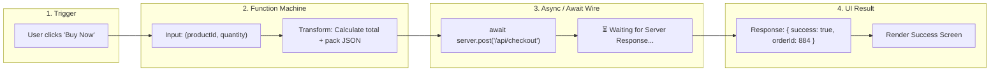

# Lesson 03: JavaScript as System Glue (Data Shapes & Mental Tracing)

## ⏱️ Class Agenda (90 Minutes)
* **00:00 - 00:25:** The 3 Data Shapes (Primitives, Objects, Arrays of Objects).
* **00:25 - 00:50:** Functions as Input ➔ Transformation ➔ Output machines.
* **00:50 - 01:15:** The "Async" Mindset (Why servers take time & `await`).
* **01:15 - 01:30:** Live Exercise: Inspecting and modifying JSON payloads with AI.

---

## 💡 What We Teach & Why (The Concept)
Beginners drown when taught JavaScript through abstract math problems (Fibonacci, reverse a linked list). In web development, **JavaScript is simply the postal service**: it packages user data into a box, sends it across the wire, unpacks server responses, and displays it.

Students need to master 3 practical mental models:
1. **Objects `{}`**: A single entity with labeled attributes (e.g. `{ name: "Laptop", price: 999 }`).
2. **Arrays `[]`**: A list of entities (e.g. `[ { product1 }, { product2 } ]`).
3. **Async / Await**: When asking an external server for data, your code cannot freeze the browser. It says: `"I'll `await` this response, and when it arrives, continue."`

If a student can read a JSON object and trace where data flows, they can build any MERN app with AI.

---

## 🏛️ Mermaid Diagram: The Function & Async Pipeline


---

## 📁 Where Things Live: Today's Focus
```
my-js-test/
├── index.html              <-- Imports script.js via <script src="script.js">
├── script.js               <-- Variables, objects, functions, and fetch calls
└── data.json               <-- Sample server response structure
```

---

## 🤖 AI Prompt Recipe for Today
Students practice the "Code Explanation & Mental Tracing Prompt":
```markdown
Here is a JavaScript function:

```javascript
async function fetchUserOrders(userId) {
  try {
    const response = await fetch(`https://api.example.com/users/${userId}/orders`);
    const data = await response.json();
    return data.filter(order => order.status === 'completed');
  } catch (err) {
    console.error('Failed to load orders', err);
  }
}
```

Please explain:
1. What does `async` and `await` do here in plain English?
2. What shape of data is returned (is it an object, array, or string)?
3. What does `.filter` do to that data?
4. If the server is down, which line runs?
```

---

---

## 📖 Glossary of Critical Terminologies (The Beginner Dictionary)

| Term | Plain-English Definition & Real-World Analogy |
| :--- | :--- |
| **Primitive Data Types** | The simplest building blocks of data: String (text), Number (digits), Boolean (true/false), null (intentional emptiness), and undefined (unassigned variable). |
| **Object `{}`** | A container that groups related properties and values under labeled keys (e.g. `{ name: "Laptop", price: 999 }`). |
| **Array `[]`** | An ordered list of items accessed by their numerical index starting at 0 (e.g. `["Apple", "Banana", "Cherry"]`). |
| **JSON (JavaScript Object Notation)** | The lightweight, human-readable universal text standard used across the internet to exchange data between clients, servers, and databases. |
| **Function** | A reusable machine of code that takes Inputs (arguments/parameters), runs a calculation or transformation, and gives back an Output (return value). |
| **Asynchronous (Async)** | Code that runs in the background without freezing the rest of your program while waiting for slow operations (like fetching data from a server 3,000 miles away). |
| **`await`** | A JavaScript keyword placed before a slow asynchronous task that says: "Pause this function right here until the server replies, but let the rest of the computer keep running." |
| **Array Methods (.map, .filter)** | `.map()` transforms every item in an array into something new (like converting raw objects into HTML cards). `.filter()` weeds out unwanted items based on a condition. |

---

## 🎯 The Non-Negotiable Key Takeaways
At the end of this class, every single student **MUST** be able to answer:
1. **What is an Object vs an Array?**
   - *Answer:* An Object `{}` is one thing with properties (`user.email`). An Array `[]` is a list of things (`users[0]`).
2. **Why do we use `await` when talking to APIs?**
   - *Answer:* Because network requests take time (milliseconds to seconds). `await` pauses that function until the server sends data back without freezing the computer.
3. **What is JSON?**
   - *Answer:* JavaScript Object Notation—the universal language for sending data between frontend, backend, and database.
