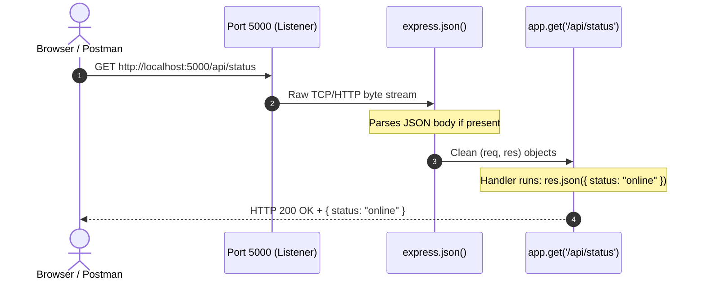

# Lesson 04: Backend Mental Model (Node.js & Express Server)

## ⏱️ Class Agenda (90 Minutes)
* **00:00 - 00:25:** What is Node.js? Running JavaScript on a machine instead of the browser.
* **00:25 - 00:45:** The Express Server Anatomy (Ports, `app.listen`, the Request-Response cycle).
* **00:45 - 01:15:** The Backend Folder Structure (`server.js`, `package.json`, `node_modules`).
* **01:15 - 01:30:** Live Exercise: Spin up an Express server on Port 5000 and test in browser.

---

## 💡 What We Teach & Why (The Concept)
Many beginners think Node.js is a new language. It's not! It's just **JavaScript liberated from the browser**. 
In the browser, JS can't touch hard drives or listen to ports for security reasons. With Node.js on a server, JS can listen for incoming internet traffic, talk to databases, read environment variables, and send data back.

**The 3 Components of an Express App:**
1. **The App Object:** `const app = express();` (The traffic control tower).
2. **Middleware:** `app.use(express.json());` (Converts incoming request strings into clean JS objects).
3. **The Listener:** `app.listen(5000, () => ...);` (Opens port 5000 and waits for internet knocks).

---

## 🏛️ Mermaid Diagram: The Express Request-Response Loop


---

## 📁 Where Things Live: Today's Focus
```
backend/
├── node_modules/           <-- Downloaded third-party libraries (NEVER edit by hand)
├── package.json            <-- Lists 'express', scripts like 'npm start'
├── package-lock.json       <-- Exact dependency version locks
└── server.js               <-- The main entry point file where app is created
```

---

## 🤖 AI Prompt Recipe for Today
Students use this prompt to generate and understand their first server:
```markdown
I am building the backend for a MERN stack application.
Please write a clean, modern `server.js` file using Express.

Requirements:
- Listen on PORT 5000 (or `process.env.PORT`).
- Use `express.json()` middleware to parse JSON bodies.
- Create a test route: `GET /api/health` that returns `{ status: "ok", timestamp: new Date() }`.
- Print a clear console log when the server starts successfully: "Server listening on port 5000".
- Explain the 3 most important lines in this file.
```

---

---

## 📖 Glossary of Critical Terminologies (The Beginner Dictionary)

| Term | Plain-English Definition & Real-World Analogy |
| :--- | :--- |
| **Runtime Environment** | The engine and ecosystem that executes code. Node.js is a server-side runtime, while V8 in Chrome is a browser-side runtime. |
| **Port** | A numbered software doorway on your computer (e.g. 5000 or 5173) where specific network programs listen for incoming internet traffic. |
| **Express.js** | A minimalist, fast web server framework for Node.js that simplifies routing, middleware, and request handling. |
| **Request (`req`)** | The object provided by Express containing everything the user sent: URL parameters, query strings, headers, and request body payload. |
| **Response (`res`)** | The object provided by Express used to craft and send the reply back to the user: setting status codes (`res.status(200)`) and JSON data (`res.json(...)`). |
| **Middleware** | A helper function that intercepts an incoming request before it reaches your final route handler, often used for parsing data, logging, or checking passwords. |
| **`express.json()`** | A mandatory built-in Express middleware that translates incoming raw JSON text streams into a ready-to-use JavaScript `req.body` object. |
| **Nodemon** | A developer utility that automatically restarts your Node server whenever you save changes in your code, saving you from manually restarting it in the terminal. |

---

## 🎯 The Non-Negotiable Key Takeaways
At the end of this class, every single student **MUST** be able to answer:
1. **What is a Port (e.g. 5000)?**
   - *Answer:* A designated "door number" on your computer where your server listens for incoming network messages.
2. **What does `express.json()` do?**
   - *Answer:* It acts as a translator that turns incoming JSON text into a usable JavaScript `req.body` object.
3. **What is the difference between `req` and `res`?**
   - *Answer:* `req` (Request) is what the user sends in; `res` (Response) is what your server sends back.
