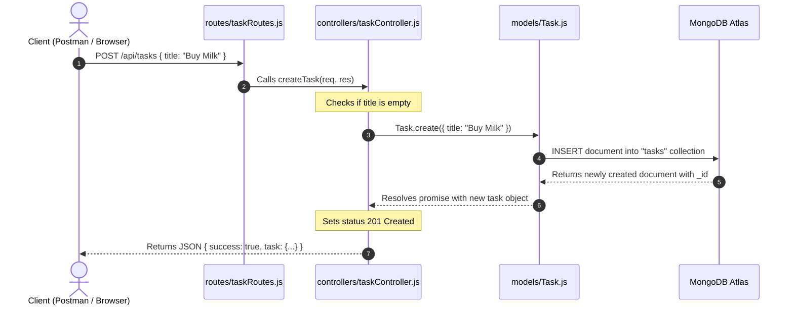

# Lesson 07: Complete Database CRUD (Routes + Controllers + DB)

## ⏱️ Class Agenda (90 Minutes)
* **00:00 - 00:25:** The MVC Separation of Concerns (Why `routes/` and `controllers/` must be separate).
* **00:25 - 00:50:** The 4 Essential Mongoose Commands (`find`, `create`, `findByIdAndUpdate`, `findByIdAndDelete`).
* **00:50 - 01:15:** Bulletproof Error Handling with `try / catch` and HTTP status codes.
* **01:15 - 01:30:** Live Exercise: Building a full CRUD API connected to real MongoDB Atlas.

---

## 💡 What We Teach & Why (The Concept)
When beginners start using AI, the AI often dumps 300 lines of spaghetti code directly into `server.js`. As soon as the app grows, it becomes impossible to debug.
Today, we instill the **MVC Professional Standard**:
1. **Routes (`routes/*.js`):** The receptionist. It only checks the URL and verb, then hands the call to the controller.
2. **Controllers (`controllers/*.js`):** The worker. It extracts `req.body` or `req.params`, queries MongoDB with `await`, and sends JSON.
3. **Models (`models/*.js`):** The blueprint. Defines what valid data looks like.

---

## 🏛️ Mermaid Diagram: The MVC Request Flow


---

## 📁 Where Things Live: Today's Focus
```
backend/
├── models/
│   └── Task.js             <-- The Schema Blueprint
├── controllers/
│   └── taskController.js   <-- getTasks, createTask, updateTask, deleteTask
├── routes/
│   └── taskRoutes.js       <-- router.get('/', getTasks).post('/', createTask)
└── server.js               <-- app.use('/api/tasks', taskRoutes)
```

---

## 🤖 AI Prompt Recipe for Today
Students practice prompting for clean MVC architecture:
```markdown
I have a Mongoose model at `server/models/Note.js` with fields: `title`, `body`, and `isPinned`.

Please create two separate clean files following professional MVC pattern:
1. `server/controllers/noteController.js`:
   - `getNotes`: Fetch all notes sorted by newest first.
   - `createNote`: Validate title exists, then `Note.create(req.body)`. Return 201.
   - `updateNote`: Use `findByIdAndUpdate(req.params.id, req.body, { new: true })`.
   - `deleteNote`: Use `findByIdAndDelete(req.params.id)`.
   - Use async/await and try/catch in all functions. Return status 400 for bad input and 500 for server errors.

2. `server/routes/noteRoutes.js`:
   - Mount these controllers to RESTful paths (`/` and `/:id`).
```

---

---

## 📖 Glossary of Critical Terminologies (The Beginner Dictionary)

| Term | Plain-English Definition & Real-World Analogy |
| :--- | :--- |
| **CRUD** | The 4 fundamental operations of any database system: Create (POST), Read (GET), Update (PUT), and Delete (DELETE). |
| **MVC (Model-View-Controller)** | A professional software architecture pattern that separates an app into 3 distinct layers: Model (data rules), View (the UI), and Controller (business logic). |
| **Controller** | A dedicated JavaScript file containing the actual worker functions that extract user input, query MongoDB with Mongoose, and return JSON responses. |
| **Router** | An Express module (`express.Router()`) that maps clean URL paths to their respective controller functions. |
| **`try / catch`** | A JavaScript safety net: code in `try` executes normally, and if any unexpected database error occurs, `catch` intercepts it so your server doesn't crash. |
| **`findByIdAndUpdate`** | A Mongoose query method that searches for a document by its unique `_id` and applies modifications, returning the updated document when `{ new: true }` is passed. |

---

## 🎯 The Non-Negotiable Key Takeaways
At the end of this class, every single student **MUST** be able to answer:
1. **Why do we separate Routes from Controllers?**
   - *Answer:* Routes declare *where* requests go (the URL); Controllers do the *actual work* (database queries and calculations).
2. **What does `{ new: true }` do in `findByIdAndUpdate`?**
   - *Answer:* It tells Mongoose to return the *updated* document rather than the original stale version.
3. **What happens if a database operation fails without `try / catch`?**
   - *Answer:* The entire Node server can crash and shut down! `try / catch` catches errors safely and sends a friendly 500 error back to the user.
