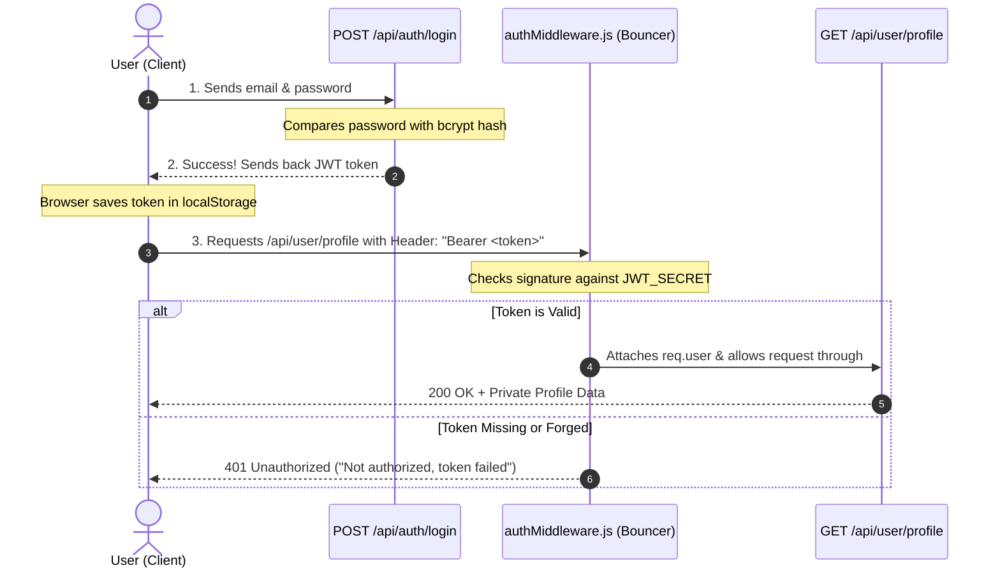

# Lesson 08: Authentication & Security (JWT, Passwords & Secrets)

## ⏱️ Class Agenda (90 Minutes)
* **00:00 - 00:25:** Password Security: Why plain-text is illegal and how `bcrypt` hashing works.
* **00:25 - 00:50:** The JWT (JSON Web Token) Mental Model: The VIP Wristband.
* **00:50 - 01:15:** The Auth Middleware "Bouncer" (`req.headers.authorization`).
* **01:15 - 01:30:** Live Exercise: Building a protected route `/api/user/profile` that rejects unauthenticated visitors.

---

## 💡 What We Teach & Why (The Concept)
Authentication often terrifies beginners because of cryptographic jargon. We demystify it using the **Concert Festival Metaphor**:
1. **At the Entrance (Login):** You show your ID and ticket (email & password).
2. **Receiving your Wristband (JWT):** The venue attaches a tamper-proof wristband stamped with an official signature (`JWT_SECRET`).
3. **Entering the VIP Lounge (Protected Routes):** The bouncer doesn't ask for your national ID every single time you buy a drink. The bouncer simply glances at your wristband signature! If the wristband is authentic, you're in. If expired or forged, you get booted (**401 Unauthorized**).

---

## 🏛️ Mermaid Diagram: The JWT Authentication Lifecycle


---

## 📁 Where Things Live: Today's Focus
```
backend/
├── middleware/
│   └── authMiddleware.js   <-- Verifies jwt.verify(token, process.env.JWT_SECRET)
├── controllers/
│   └── authController.js   <-- registerUser, loginUser, getUserProfile
├── routes/
│   └── authRoutes.js       <-- router.get('/profile', protect, getUserProfile)
└── .env                    <-- JWT_SECRET=super_secret_jwt_key_12345
```

---

## 🤖 AI Prompt Recipe for Today
Students practice prompting for complete JWT authentication:
```markdown
I am building a MERN stack application.
Please create an authentication flow with JWT and bcrypt:

1. `server/middleware/authMiddleware.js`:
   - Extracts Bearer token from `req.headers.authorization`.
   - Verifies token using `jwt.verify(token, process.env.JWT_SECRET)`.
   - Fetches user from DB (excluding password) and attaches to `req.user`.
   - Returns 401 if missing or invalid.

2. `server/controllers/authController.js`:
   - `registerUser`: Hashes password with bcrypt (salt 10) and creates user.
   - `loginUser`: Compares password with `bcrypt.compare`, signs and returns JWT token.
   - `getUserProfile`: Returns `req.user`.

Explain how the `protect` middleware is plugged into a route in `server/routes/authRoutes.js`.
```

---

---

## 📖 Glossary of Critical Terminologies (The Beginner Dictionary)

| Term | Plain-English Definition & Real-World Analogy |
| :--- | :--- |
| **Authentication (AuthN)** | Verifying "Who are you?" by checking user identity through credentials like an email and password. |
| **Authorization (AuthZ)** | Verifying "What are you allowed to do?" (e.g. Can this user delete a post, or only view it? Are they an admin?). |
| **Plain-Text Password** | An unencrypted password written exactly as typed (e.g. "secret123"). Storing plain text in a database is a dangerous security violation. |
| **Bcrypt Hashing & Salt** | A one-way cryptographic mathematical function that scrambles passwords into an irreversible string, combined with random characters (Salt) to prevent rainbow-table attacks. |
| **JWT (JSON Web Token)** | A compact, URL-safe digital token formatted as `header.payload.signature` that acts as a tamper-proof VIP wristband verifying a logged-in user. |
| **Bearer Token** | The industry-standard format for passing JWT tokens inside the HTTP `Authorization` request header: `Authorization: Bearer <token>`. |
| **Auth Middleware (Guard)** | A gatekeeper function that checks if an incoming request contains a valid, unexpired JWT signed with `process.env.JWT_SECRET` before allowing access to private routes. |

---

## 🎯 The Non-Negotiable Key Takeaways
At the end of this class, every single student **MUST** be able to answer:
1. **Why can't we store plain text passwords in MongoDB?**
   - *Answer:* If the database is compromised, all user accounts are stolen. Hashing with `bcrypt` is a one-way mathematical scramble that cannot be reversed.
2. **What are the 3 parts of a JWT?**
   - *Answer:* Header (algorithm), Payload (user data like `_id`), and Signature (tamper-proof seal signed with your secret key).
3. **What is Middleware in Express?**
   - *Answer:* A security guard function that sits between the incoming request and your final controller, deciding whether to let the request proceed or block it with a 401 error.
