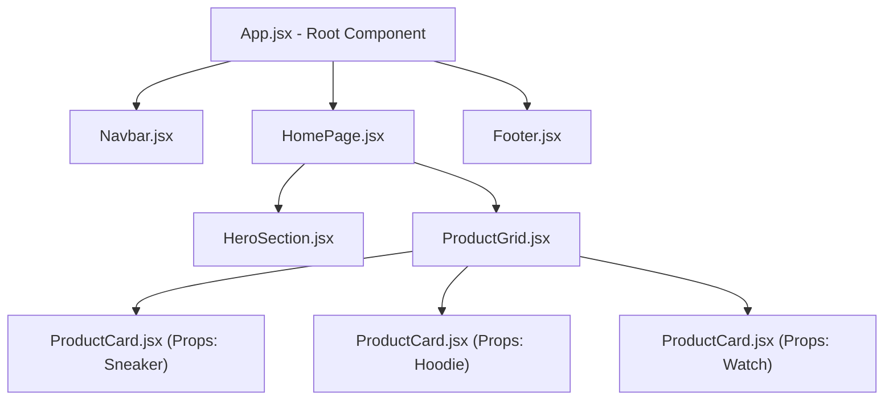

# Lesson 09: React Mental Model & Modular Thinking

## ⏱️ Class Agenda (90 Minutes)
* **00:00 - 00:25:** The Single Page Application (SPA) Mindset: Why no full page reloads?
* **00:25 - 00:45:** JSX Syntax: Writing HTML-like structures inside JavaScript.
* **00:45 - 01:15:** The Component Hierarchy: Decomposing a webpage into Lego bricks (`components/` vs `pages/`).
* **01:15 - 01:30:** Live Exercise: Booting a Vite project and creating a reusable `<ProductCard />` component with props.

---

## 💡 What We Teach & Why (The Concept)
Traditional websites in the 2000s reloaded the entire white screen every time you clicked a link. 
**React changes everything:**
1. **The SPA Architecture:** The browser downloads one single HTML shell (`index.html`). React takes control of `<div id="root"></div>` and paints UI elements dynamically using JavaScript.
2. **Components = Custom HTML Tags:** Instead of copying and pasting 40 lines of HTML for every product, you create `<ProductCard title="Sneakers" price={99} />` and reuse it 100 times.
3. **Props = The Arguments:** Props are how parent components pass data down to child components.

---

## 🏛️ Mermaid Diagram: The Component Tree Hierarchy


---

## 📁 Where Things Live: Today's Focus
```
client/
├── public/                 <-- Static icons and fonts
├── src/
│   ├── components/         <-- Reusable UI widgets: Navbar.jsx, ProductCard.jsx
│   ├── pages/              <-- Full screen pages: HomePage.jsx, AboutPage.jsx
│   ├── App.jsx             <-- Top-level component assembly
│   ├── main.jsx            <-- Mounts React to <div id="root">
│   └── index.css           <-- Global styles
├── index.html              <-- Contains <div id="root"></div>
└── package.json            <-- Lists 'react', 'react-dom'
```

---

## 🤖 AI Prompt Recipe for Today
Students practice prompting for modular React components:
```markdown
I am building a React frontend using Vite.
Please create a reusable component at `client/src/components/ProductCard.jsx`.

Requirements:
- Accept props: `title`, `price`, `imageUrl`, `rating`, `inStock`.
- Design: Clean modern dark card with rounded borders and a glowing hover effect.
- If `inStock` is false, show a red "Sold Out" badge and disable the button.
- Include a button: "Add to Bag" with a hover state.
- Show me how to import and use 3 instances of `<ProductCard />` inside `client/src/App.jsx`.
```

---

---

## 📖 Glossary of Critical Terminologies (The Beginner Dictionary)

| Term | Plain-English Definition & Real-World Analogy |
| :--- | :--- |
| **SPA (Single Page Application)** | A modern web architecture where the browser loads one single HTML page, and JavaScript dynamically updates the screen without white flashes or page reloads. |
| **Component** | An independent, reusable piece of user interface (like a button, card, or navbar) written as a JavaScript function that returns JSX. |
| **JSX (JavaScript XML)** | A syntax extension for JavaScript that looks like HTML, allowing you to design user interfaces directly inside your React components. |
| **Props (Properties)** | Read-only arguments passed from a parent component down to a child component (e.g. `<ProductCard title="Phone" price={799} />`). |
| **Component Tree** | The hierarchical parent-child diagram showing how components are nested inside each other to form a complete webpage. |
| **Virtual DOM** | React's lightweight in-memory copy of the real browser DOM, used to calculate the fastest, minimal updates before repainting the screen. |
| **Vite** | A blazing-fast next-generation frontend build tool and development server used to create modern React applications. |

---

## 🎯 The Non-Negotiable Key Takeaways
At the end of this class, every single student **MUST** be able to answer:
1. **What is a Component in React?**
   - *Answer:* A JavaScript function that returns visual JSX UI (like a reusable custom HTML tag).
2. **What are Props?**
   - *Answer:* Arguments passed into a component from its parent (e.g. `<Card title="MacBook" />`). Props are read-only!
3. **What is the difference between `components/` and `pages/`?**
   - *Answer:* `components/` holds small reusable pieces (buttons, cards, navbars); `pages/` holds the full screens that assemble those components together.
