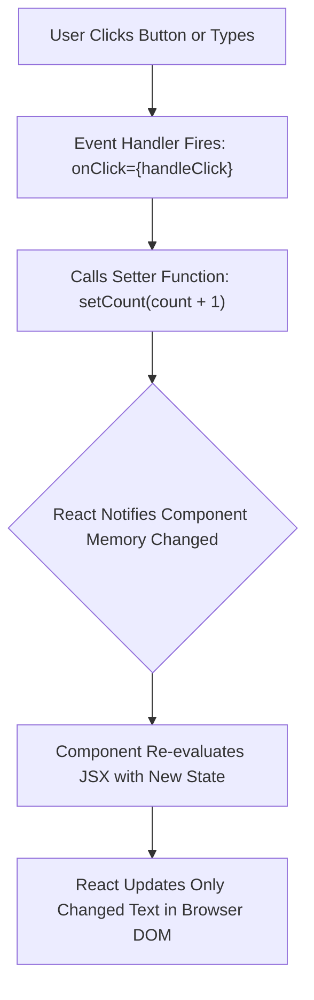

# Lesson 10: State & User Interactivity (useState & Events)

## ⏱️ Class Agenda (90 Minutes)
* **00:00 - 00:25:** The "Memory of a Component": Why `let count = 0` fails in React.
* **00:25 - 00:45:** The `useState` Hook Anatomy: `const [value, setValue] = useState(initial)`.
* **00:45 - 01:15:** Event Handlers (`onClick`, `onChange`) & Controlled Form Inputs.
* **01:15 - 01:30:** Live Exercise: Building an interactive Todo item creator or shopping cart counter.

---

## 💡 What We Teach & Why (The Concept)
In traditional JavaScript, if you wanted to update a number on screen, you wrote `document.getElementById('num').innerText = 5`.
In React, **you never touch the DOM manually**. 

Instead:
1. You store the value in **State** (`useState`).
2. When you call the setter function (`setCount(count + 1)`), React notices that memory changed.
3. React automatically **re-runs the component function** and repaints the changed part of the screen at 60 FPS.

For forms, we use **Controlled Components**: the input box's display value is locked to state (`value={name}`), and whenever the user types a single keystroke, `onChange` updates state.

---

## 🏛️ Mermaid Diagram: The State Re-Render Cycle


---

## 📁 Where Things Live: Today's Focus
```
client/src/
├── components/
│   ├── Counter.jsx         <-- Local state: const [count, setCount] = useState(0)
│   └── TaskForm.jsx        <-- Form state: const [title, setTitle] = useState('')
└── App.jsx
```

---

## 🤖 AI Prompt Recipe for Today
Students practice prompting for interactive React forms:
```markdown
I am building a React component using Vite and `useState`.
Please create an interactive form component at `client/src/components/CreateTaskForm.jsx`.

Requirements:
- Fields in state:
  - `title` (String, required)
  - `priority` (String, default 'medium', options: 'low', 'medium', 'high')
- Handle form submission `onSubmit`:
  - Prevent default browser page reload (`e.preventDefault()`).
  - If title is empty, show a small red error message below the input.
  - If valid, invoke an `onAddTask(newTask)` callback prop and reset the form inputs to empty strings.
- Add smooth button hover and active states.
```

---

---

## 📖 Glossary of Critical Terminologies (The Beginner Dictionary)

| Term | Plain-English Definition & Real-World Analogy |
| :--- | :--- |
| **State** | The internal memory of a React component that holds values that can change over time based on user interactions (e.g. typing, clicking, toggling). |
| **React Hook** | Special functions provided by React (starting with `use`, like `useState` or `useEffect`) that allow functional components to tap into state and lifecycle features. |
| **`useState`** | The core React hook that declares a state variable and gives you an updater function (e.g. `const [count, setCount] = useState(0)`). |
| **Re-render** | The process where React re-executes a component function and repaints the screen because one of its state variables changed. |
| **Event Handler** | A function triggered in response to a user action in the browser (e.g. `onClick`, `onChange`, `onSubmit`). |
| **Controlled Component** | An input form element whose display value is strictly controlled by React state (`value={text}` and `onChange={e => setText(e.target.value)}`). |
| **`e.preventDefault()`** | A method called on form submission events that cancels the browser's default behavior of reloading the entire webpage. |

---

## 🎯 The Non-Negotiable Key Takeaways
At the end of this class, every single student **MUST** be able to answer:
1. **Why does changing a regular variable (`let x = 10`) not update the screen in React?**
   - *Answer:* React only watches State. Regular variables change silently without triggering a re-render.
2. **What are the two items returned by `useState(0)`?**
   - *Answer:* The current value (`count`) and the updater function (`setCount`).
3. **Why do we call `e.preventDefault()` on form submit?**
   - *Answer:* By default, browser forms reload the entire webpage. In modern SPAs, `e.preventDefault()` stops the reload so React can handle the submission with JavaScript.
