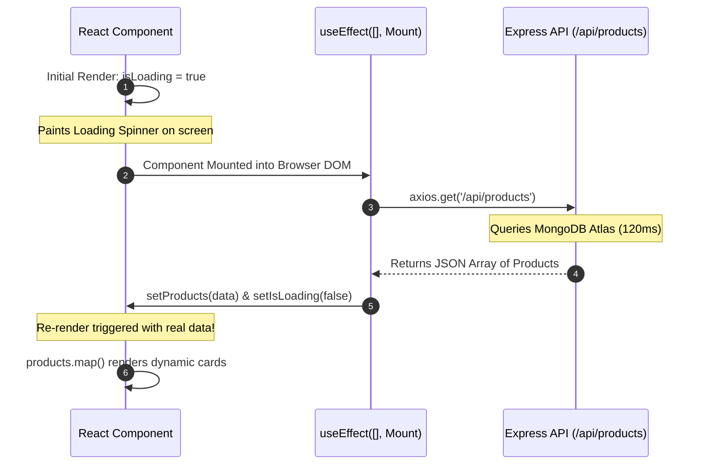

# Lesson 11: Side Effects & Fetching Real Data (useEffect & Axios)

## ⏱️ Class Agenda (90 Minutes)
* **00:00 - 00:25:** The Infinite Loop Trap: Why `fetch()` cannot sit naked inside a component body.
* **00:25 - 00:50:** The `useEffect` Hook & The Empty Dependency Array `[]` (Run on Mount).
* **00:50 - 01:15:** The 3 UI States of Data Fetching: Loading, Error, and Success (`.map()`).
* **01:15 - 01:30:** Live Exercise: Fetching live data from an Express API or public JSON placeholder.

---

## 💡 What We Teach & Why (The Concept)
If a beginner writes `fetch('/api/tasks').then(res => setTasks(res))` directly inside their component:
1. The component renders.
2. `fetch` runs and calls `setTasks()`.
3. State changes, so React **re-renders** the component!
4. The component renders again... and calls `fetch` again!
5. **Boom: Infinite loop, browser crashes, server gets DDoS'd.**

**The Solution is `useEffect`:**
`useEffect(() => { fetchTasks(); }, []);`
The empty bracket `[]` tells React: **"Only run this function ONCE when this component first mounts on the screen."**

**The 3 Golden UI States:**
Every professional frontend app must handle:
1. `isLoading === true` ➔ Show a spinner / skeleton card.
2. `error !== null` ➔ Show a red error banner with a retry button.
3. `data.length > 0` ➔ Use `.map()` to render list items with unique `key={item._id}`.

---

## 🏛️ Mermaid Diagram: The Data Fetching Lifecycle


---

## 📁 Where Things Live: Today's Focus
```
client/src/
├── services/
│   └── api.js              <-- axios.create({ baseURL: 'http://localhost:5000/api' })
├── pages/
│   └── ProductsPage.jsx    <-- Uses useEffect to fetch and render list
└── components/
    ├── Spinner.jsx         <-- Loading animation
    └── ProductCard.jsx     <-- Individual mapped item
```

---

## 🤖 AI Prompt Recipe for Today
Students practice prompting for the 3-state data fetch pattern:
```markdown
I am building a React page at `client/src/pages/FeedPage.jsx` using Vite and `axios`.

Requirements:
- Call `http://localhost:5000/api/posts` inside a `useEffect` hook that runs only once on mount.
- Manage 3 state variables:
  - `posts` (Array, default `[]`)
  - `isLoading` (Boolean, default `true`)
  - `error` (String or null, default `null`)
- Render:
  - If `isLoading`, show a clean spinning loader.
  - If `error`, show a styled red banner with an error message.
  - If data is loaded and empty, show "No posts found".
  - If data exists, map over posts and render `<PostCard key={post._id} post={post} />`.
```

---

---

## 📖 Glossary of Critical Terminologies (The Beginner Dictionary)

| Term | Plain-English Definition & Real-World Analogy |
| :--- | :--- |
| **Side Effect** | Any operation that reaches outside of a component's pure rendering logic (e.g. fetching data from an external API, setting timers, or altering browser storage). |
| **Mounting** | The exact moment when a React component is first rendered and inserted into the browser's visible DOM tree. |
| **`useEffect`** | The React hook used to safely run side effects after a component mounts or after specified state values change. |
| **Dependency Array `[]`** | The second argument passed to `useEffect`: an empty array `[]` tells React to run the effect only once when the component first mounts. |
| **Axios** | A popular, feature-rich promise-based HTTP client library for JavaScript used to make GET, POST, and DELETE requests to backend APIs. |
| **Loading State** | A temporary UI state displayed while waiting for asynchronous network data to arrive, preventing blank screens using spinners or skeleton loaders. |
| **List Key (`key={item._id}`)** | A unique string attribute required by React when mapping over lists so it can track, update, or remove individual elements efficiently. |

---

## 🎯 The Non-Negotiable Key Takeaways
At the end of this class, every single student **MUST** be able to answer:
1. **What happens if you fetch data without `useEffect`?**
   - *Answer:* It creates an infinite loop where the component fetches, re-renders, and fetches again forever until the app crashes.
2. **What does the empty array `[]` mean at the end of `useEffect`?**
   - *Answer:* It tells React to run this effect only once when the component first appears on screen.
3. **Why is a unique `key` prop required when using `.map()`?**
   - *Answer:* React uses the `key` (usually `_id`) to track which exact items changed, added, or deleted without having to re-render the entire list.
