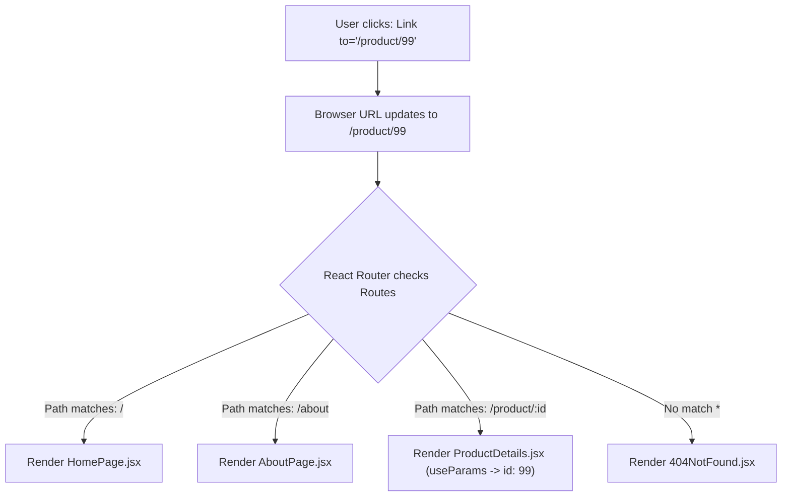

# Lesson 12: Multi-Page Navigation (React Router DOM)

## ⏱️ Class Agenda (90 Minutes)
* **00:00 - 00:25:** The Problem with `<a href>` (Why traditional links destroy React state & cause white flashes).
* **00:25 - 00:50:** The `react-router-dom` Triad: `BrowserRouter`, `Routes`, and `Route`.
* **00:50 - 01:15:** The `<Link to="...">` component and Dynamic URL Params (`useParams()`).
* **01:15 - 01:30:** Live Exercise: Building a multi-page app with Home, Product Catalog, and Product Details (`/product/:id`).

---

## 💡 What We Teach & Why (The Concept)
If you write `<a href="/about">About</a>` in a React app:
1. The browser discards everything in memory.
2. It requests a whole new HTML page from the server.
3. Your state resets, and the user experiences a frustrating white screen flash.

**The Solution is Client-Side Routing:**
`react-router-dom` intercepts link clicks:
* Instead of reloading the page, it changes the browser URL using the HTML5 History API.
* It swaps out the component displayed inside `<Routes>` in **0 milliseconds**.
* Shared components like your `<Navbar />` and `<Footer />` stay persistently mounted on screen!

---

## 🏛️ Mermaid Diagram: Client-Side Route Resolution


---

## 📁 Where Things Live: Today's Focus
```
client/src/
├── App.jsx                 <-- <Routes><Route path="/" element={<Home />} /></Routes>
├── components/
│   └── Navbar.jsx          <-- Uses <Link to="/"> and <Link to="/about">
└── pages/
    ├── HomePage.jsx        <-- Path: /
    ├── AboutPage.jsx       <-- Path: /about
    └── ProductDetail.jsx   <-- Path: /product/:id (reads const { id } = useParams())
```

---

## 🤖 AI Prompt Recipe for Today
Students practice prompting for complete multi-page routing:
```markdown
I am building a React application using `react-router-dom` (v6) with Vite.
Please configure the routing setup inside `client/src/App.jsx`.

Requirements:
- Pages to route:
  1. `/` -> `HomePage`
  2. `/products` -> `ProductListPage`
  3. `/products/:id` -> `ProductDetailPage` (show how `useParams` reads the ID)
  4. `*` -> `NotFoundPage` (404)
- Maintain a shared persistent `<Navbar />` at the top of all pages.
- Use `<Link to="...">` inside the Navbar for fast transitions without page reload.
```

---

---

## 📖 Glossary of Critical Terminologies (The Beginner Dictionary)

| Term | Plain-English Definition & Real-World Analogy |
| :--- | :--- |
| **Client-Side Routing** | Navigating between different page views within a Single Page Application using JavaScript, changing the URL without asking the server for a new HTML file. |
| **React Router DOM** | The standard routing library for React applications that enables client-side URL routing and multi-page layouts. |
| **`BrowserRouter`** | The top-level parent component that connects React Router to the browser's native address bar and history API. |
| **`Routes` & `Route`** | Components used to map URL paths to visual page components (e.g. `<Route path="/products" element={<ProductsPage />} />`). |
| **`<Link to="...">`** | The React Router component used instead of `<a href>` to navigate smoothly between pages without reloading the browser window. |
| **Dynamic Route (`:id`)** | A URL segment prefixed with a colon that acts as a wildcard parameter matching any dynamic value (e.g. `/product/842`). |
| **`useParams`** | A React Router hook that extracts the dynamic parameters from the current URL path into a clean JavaScript object. |

---

## 🎯 The Non-Negotiable Key Takeaways
At the end of this class, every single student **MUST** be able to answer:
1. **Why must we use `<Link to="...">` instead of `<a href="...">` in React?**
   - *Answer:* `<a href>` triggers a full browser reload and wipes out state; `<Link>` changes the page instantly without reloading.
2. **What does `:id` mean in a route path (`/product/:id`)?**
   - *Answer:* It is a dynamic wildcard parameter that captures whatever value is typed in that URL segment.
3. **Which hook is used to read dynamic URL parameters?**
   - *Answer:* `useParams()` from `react-router-dom`.
