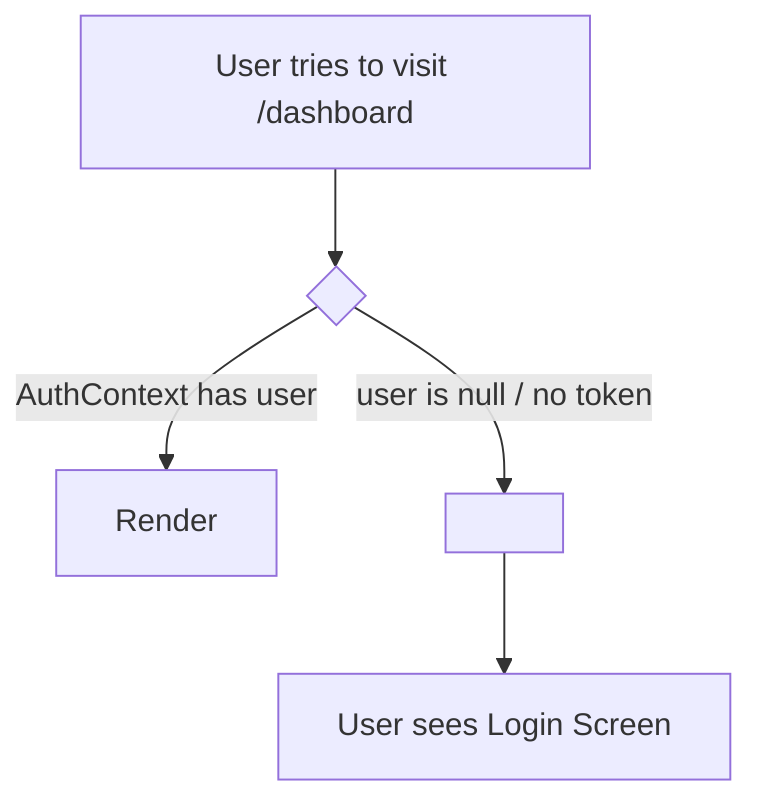

# Lesson 13: Frontend Authentication & Protected Routes

## ⏱️ Class Agenda (90 Minutes)
* **00:00 - 00:25:** Storing the JWT Token in `localStorage` (The persistence layer).
* **00:25 - 00:50:** The React Context API: Solving the "Prop Drilling" nightmare for user auth.
* **00:50 - 01:15:** Conditional UI (Showing "Logout" vs "Login") & The `<ProtectedRoute>` component.
* **01:15 - 01:30:** Live Exercise: Locking down the `/dashboard` route so only logged-in users can enter.

---

## 💡 What We Teach & Why (The Concept)
If you have 15 components on a website, you don't want to pass `user={user}` through all 15 components by hand (Prop Drilling). 
**React Context creates a Global Radio Station:**
* The `<AuthProvider>` broadcasts the logged-in user state to every component in the entire app.
* Any component (like the Navbar) can tune in using `const { user, logout } = useAuth()`.

**The Protected Route Shield:**
When someone types `/dashboard` into their browser:
* `<ProtectedRoute>` checks if `user` exists in Context.
* If yes ➔ Renders the Dashboard.
* If no ➔ Redirects them straight to `/login` using `<Navigate to="/login" />`.

---

## 🏛️ Mermaid Diagram: Protected Route Shield


---

## 📁 Where Things Live: Today's Focus
```
client/src/
├── context/
│   └── AuthContext.jsx     <-- createContext, AuthProvider, useAuth hook
├── components/
│   ├── ProtectedRoute.jsx  <-- Redirects unauthenticated visitors
│   └── Navbar.jsx          <-- Conditionally renders Login or Logout
├── pages/
│   ├── LoginPage.jsx       <-- Saves token to localStorage on submit
│   └── Dashboard.jsx       <-- Protected behind <ProtectedRoute>
└── App.jsx
```

---

## 🤖 AI Prompt Recipe for Today
Students practice prompting for complete frontend auth state:
```markdown
I am building a React application with `react-router-dom` (v6).
Please create a production-ready Authentication Context and Protected Route:

1. `client/src/context/AuthContext.jsx`:
   - Initialize `user` state by checking `localStorage.getItem('token')`.
   - Provide `login(token, userData)`: saves to localStorage and sets state.
   - Provide `logout()`: removes from localStorage and clears state.
   - Export a custom `useAuth()` hook for easy consumption.

2. `client/src/components/ProtectedRoute.jsx`:
   - Use `useAuth()`. If `user` is not authenticated, redirect to `/login` using `<Navigate to="/login" replace />`.
   - Otherwise, render `{children}`.

3. Show how to wrap `/dashboard` inside `<ProtectedRoute>` in `App.jsx`.
```

---

---

## 📖 Glossary of Critical Terminologies (The Beginner Dictionary)

| Term | Plain-English Definition & Real-World Analogy |
| :--- | :--- |
| **`localStorage`** | A persistent key-value storage system built into the browser that retains saved data (like JWT tokens) even after closing or refreshing the tab. |
| **Prop Drilling** | The awkward, error-prone process of passing props down through many layers of intermediate child components that don't actually need the data themselves. |
| **React Context API** | A built-in React system that creates a "global broadcasting station", making data (like logged-in user auth) accessible to any component instantly. |
| **`createContext` & `Provider`** | `createContext()` initializes the shared context vault; `<AuthContext.Provider value={...}>` wraps your app and broadcasts data to all children. |
| **Custom Hook (`useAuth`)** | A user-created helper hook that packages Context consumption into a clean, single-line call: `const { user, logout } = useAuth()`. |
| **Protected Route** | A component wrapper that checks if a user is authenticated; if yes, it renders the private screen; if no, it redirects them to `/login`. |
| **`<Navigate replace />`** | A React Router component used inside route guards to immediately redirect unauthorized visitors to a different page. |

---

## 🎯 The Non-Negotiable Key Takeaways
At the end of this class, every single student **MUST** be able to answer:
1. **What is Prop Drilling and how does React Context solve it?**
   - *Answer:* Prop drilling is awkwardly passing data through many parent-child levels. Context makes data (like user auth) globally accessible everywhere with one hook.
2. **Where is the JWT token stored so users stay logged in after refreshing?**
   - *Answer:* In `localStorage` (`localStorage.setItem('token', token)`).
3. **How does a Protected Route work?**
   - *Answer:* It checks if a user token exists; if missing, it redirects to `/login` using `<Navigate />`.
