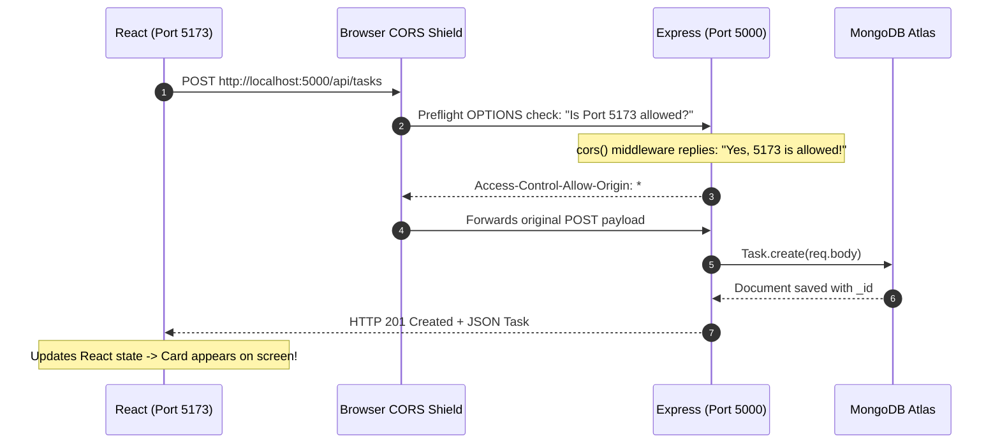

# Lesson 14: The Full-Stack Handshake (Connecting React to Express & CORS)

## ⏱️ Class Agenda (90 Minutes)
* **00:00 - 00:25:** The Full-Stack Architecture: Running Port 5173 (React) and Port 5000 (Express) concurrently.
* **00:25 - 00:50:** The CORS Policy: Why browsers block cross-origin requests & how `cors()` fixes it.
* **00:50 - 01:15:** The Axios Base Client & Environment Variables (`VITE_API_URL`).
* **01:15 - 01:30:** Live Exercise: End-to-end form submission in React creating a document in MongoDB Atlas.

---

## 💡 What We Teach & Why (The Concept)
Today is the magic moment where the two halves of the brain connect.
Up to now:
* Backend ran on `http://localhost:5000`
* Frontend ran on `http://localhost:5173`

When React tries to talk to Express for the first time, browsers will violently block the request with a **CORS (Cross-Origin Resource Sharing)** error. 
We teach students:
1. **The Origin:** Origin = Protocol (`http`) + Domain (`localhost`) + Port (`5173`).
2. **The CORS Handshake:** Because Port 5173 != Port 5000, Express must explicitly declare: `"I allow requests from origin http://localhost:5173"`.
3. **The Axios Service:** Centralizing API calls so you never hardcode `http://localhost:5000` in 20 different components.

---

## 🏛️ Mermaid Diagram: The Full-Stack Handshake


---

## 📁 Where Things Live: Today's Focus
```
my-mern-app/
├── client/
│   ├── .env                <-- VITE_API_URL=http://localhost:5000/api
│   └── src/
│       └── services/
│           └── api.js      <-- Axios instance with baseURL & auth headers
└── server/
    ├── .env                <-- PORT=5000, MONGO_URI, JWT_SECRET
    └── server.js           <-- const cors = require('cors'); app.use(cors());
```

---

## 🤖 AI Prompt Recipe for Today
Students practice prompting for the full-stack connection:
```markdown
I have a MERN monorepo with `client/` (Vite) and `server/` (Express).

Please provide:
1. In `server/server.js`: Configure the `cors` package to allow requests from `http://localhost:5173` and allow credentials and Authorization headers.
2. In `client/src/services/api.js`: Create an Axios instance that:
   - Uses `import.meta.env.VITE_API_URL` as baseURL.
   - Automatically attaches the Bearer token from `localStorage.getItem('token')` to every outgoing request using an Axios interceptor.
3. Show a complete React component example that submits a new task and displays the updated list in real time.
```

---

---

## 📖 Glossary of Critical Terminologies (The Beginner Dictionary)

| Term | Plain-English Definition & Real-World Analogy |
| :--- | :--- |
| **Origin** | The combination of Protocol (`http`), Domain/Host (`localhost`), and Port (`5173`). Two URLs are only same-origin if all three match exactly. |
| **CORS (Cross-Origin Resource Sharing)** | A browser security mechanism that restricts web pages from making API requests to a domain or port different from the one that served the page. |
| **Same-Origin Policy (SOP)** | A critical browser security rule that stops malicious scripts on one website from secretly making requests to another website where you are logged in. |
| **Preflight Request (OPTIONS)** | An automatic preliminary check sent by the browser to the backend asking: "Does your server permit requests from my origin, with my headers?" |
| **`Access-Control-Allow-Origin`** | The HTTP header sent by the Express server telling the browser which client origins are permitted to access its data (e.g. `*` or `http://localhost:5173`). |
| **Axios Interceptor** | A global middleware hook in Axios that automatically injects headers (like `Authorization: Bearer <token>`) into every outgoing request before it leaves the browser. |
| **Monorepo** | A software repository structure where both the frontend (`client/`) and backend (`server/`) codebases live together in one organized project folder. |

---

## 🎯 The Non-Negotiable Key Takeaways
At the end of this class, every single student **MUST** be able to answer:
1. **What causes a CORS error?**
   - *Answer:* The browser blocks requests when a frontend (Port 5173) calls a backend on a different port or domain without the backend's explicit permission.
2. **How is CORS solved in Express?**
   - *Answer:* By installing `cors` and adding `app.use(cors())` before route handlers in `server.js`.
3. **Why do we use `VITE_API_URL` in an environment variable?**
   - *Answer:* Because locally it points to `localhost:5000`, but in production it will point to your deployed live server (e.g. `https://my-api.onrender.com`).
