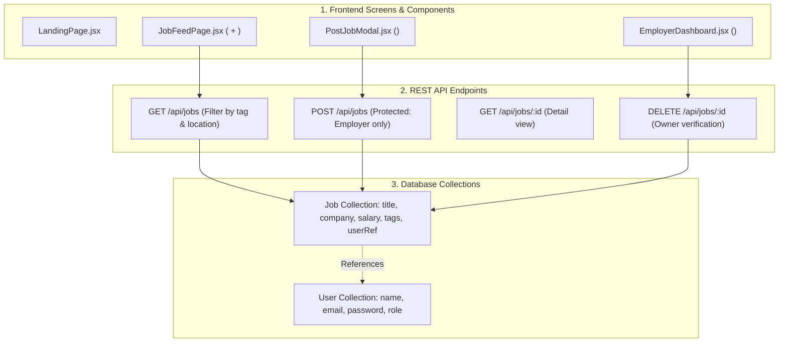

# Lesson 15: Capstone Project Architecture & PRD Prompting

## ⏱️ Class Agenda (90 Minutes)
* **00:00 - 00:25:** The Golden Rule of Modern AI Engineering: "Spec Before Code" (Why zero-spec prompting leads to chaos).
* **00:25 - 00:50:** Writing a 1-Page PRD (User Stories, Data Entities, User Flow).
* **00:50 - 01:15:** Translating PRD to Architecture: Database Schemas, API Endpoints, and Component Hierarchy.
* **01:15 - 01:30:** Live Exercise: Students finalize and lock down their Capstone Project PRD with AI.

---

## 💡 What We Teach & Why (The Concept)
When an amateur uses AI, they prompt: *"Build me a modern SaaS app like Airbnb."* 
The AI hallucinates, spits out disconnected fragments, and breaks everything.

When a **Lead System Architect** uses AI, they write a **PRD (Product Requirements Document)**:
1. **The User Persona & Core Loop:** Who is using this? What is the #1 action they take?
2. **The Data Models:** What collections exist in MongoDB and how do they link together (e.g. `User` ➔ `JobPost`)?
3. **The API Specification:** Exactly what URLs and verbs does the frontend need?
4. **The Page Structure:** What screens exist, and what components populate them?

With this blueprint locked down, building with AI becomes a fast, modular, and error-free assembly process.

---

## 🏛️ Mermaid Diagram: The Capstone Architecture Blueprint


---

## 📁 Where Things Live: Today's Focus
```
my-capstone-project/
├── docs/
│   ├── PRD.md              <-- Plain English user stories and requirements
│   └── API_SPEC.md         <-- Table of endpoints, HTTP verbs, and sample payloads
├── client/
└── server/
```

---

## 🤖 AI Prompt Recipe for Today
Students use this prompt to generate their complete architectural blueprint:
```markdown
I want to build a MERN stack capstone project: "A Tech Job Board with Employer Posting and Applicant Tracking".

Please act as a Principal Full-Stack Software Architect and generate:
1. Database Models (Mongoose):
   - Provide exact schema definitions for `User` and `Job`.
2. REST API Specification:
   - Provide a table of all endpoints, HTTP verbs, controller names, and whether auth protection is required.
3. Frontend Page & Component Tree:
   - Break down the React screens into modular components.
4. Step-by-Step Build Order:
   - List the 5 sequential phases to build and verify this app without getting overwhelmed.
```

---

---

## 📖 Glossary of Critical Terminologies (The Beginner Dictionary)

| Term | Plain-English Definition & Real-World Analogy |
| :--- | :--- |
| **PRD (Product Requirements Document)** | A comprehensive blueprint describing what problem a product solves, who will use it, the full list of features, and technical constraints before coding. |
| **User Story** | A feature description written from the perspective of an end-user: "As a [user type], I want to [action], so that I can [benefit]". |
| **Data Modeling** | The architectural process of defining which data entities exist, what fields they contain, and how they reference each other in a database. |
| **API Specification (Contract)** | A formal table documenting every endpoint URL, supported HTTP verb, required headers, request payloads, and expected status codes. |
| **Scope Creep** | The dangerous tendency for a software project to continuously expand with unplanned features, leading to unfinished, buggy applications. |
| **MVP (Minimum Viable Product)** | The simplest, most focused version of a product that successfully delivers its core value proposition to users. |

---

## 🎯 The Non-Negotiable Key Takeaways
At the end of this class, every single student **MUST** be able to answer:
1. **Why must you define your database models before asking AI for frontend code?**
   - *Answer:* The frontend only displays what the database provides. If you don't know the shape of your data, the AI will invent conflicting props that break your UI.
2. **What are the 3 sections of every good PRD?**
   - *Answer:* User Stories (features), Data Schema (entities), and API Routes (contracts).
3. **What is modular building?**
   - *Answer:* Building and verifying one feature end-to-end (Model ➔ Route ➔ Component) before starting the next feature.
