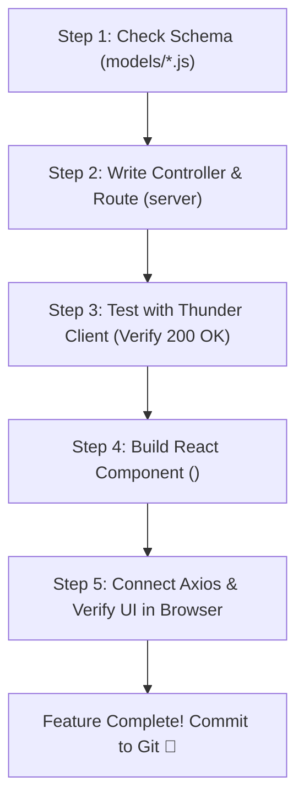

# Lesson 16: Live Capstone Building & AI Pairing Workflows

## ⏱️ Class Agenda (90 Minutes)
* **00:00 - 00:20:** The "One Feature at a Time" Discipline (Why building 5 features at once causes total failure).
* **00:20 - 00:45:** Providing Context to AI: Giving the AI both the Model and the Component.
* **00:45 - 01:15:** Building Advanced Features: Regex Search (`$regex`) & Dynamic Filter Bars.
* **01:15 - 01:30:** Live Exercise: Implementing live instant search in their Capstone project.

---

## 💡 What We Teach & Why (The Concept)
The biggest mistake beginners make in the AI era is asking AI to build 6 screens simultaneously. The code will fail to compile, and the student won't know which of the 14 new files caused the problem.

We drill the **5-Step Feature Assembly Loop**:
1. **Model:** Check if the Mongoose schema has the required fields.
2. **Backend Route & Controller:** Create the endpoint (e.g. `GET /api/jobs?search=react`).
3. **API Test:** Verify the endpoint returns JSON in Thunder Client or Postman.
4. **React Component:** Build the UI element (e.g. `<SearchInput />`).
5. **Full Wire Connection:** Connect the input to Axios and verify live on screen.

Only once this loop is complete and working do we move to the next feature!

---

## 🏛️ Mermaid Diagram: The 5-Step Assembly Loop


---

## 📁 Where Things Live: Today's Focus
```
my-capstone/
├── server/controllers/
│   └── jobController.js    <-- Query with { $regex: req.query.search, $options: 'i' }
├── client/src/
│   ├── components/
│   │   └── SearchBar.jsx   <-- Input with debounce or onKeyDown trigger
│   └── pages/
│       └── JobFeedPage.jsx <-- Triggers API re-fetch when search query changes
```

---

## 🤖 AI Prompt Recipe for Today
Students practice prompting for backend search & filtering:
```markdown
I am building a search feature for my MERN Capstone project.
Here is my Mongoose model in `server/models/Job.js`:
- Fields: `title`, `company`, `location`, `salary`, `category`.

Please implement:
1. In `server/controllers/jobController.js`:
   - Update `getJobs` to accept query parameters: `?search=` and `?category=`.
   - If `search` is provided, perform case-insensitive regex matching on `title` or `company`.
   - If `category` is provided, filter by exact category match.
   - Return sorted by newest first.

2. In `client/src/components/SearchBar.jsx`:
   - An input field and category dropdown that passes `(search, category)` back to parent on change.
```

---

---

## 📖 Glossary of Critical Terminologies (The Beginner Dictionary)

| Term | Plain-English Definition & Real-World Analogy |
| :--- | :--- |
| **Debounce** | A programming technique that delays executing a search function until the user stops typing for a few hundred milliseconds, preventing thousands of wasted API calls. |
| **Regex (Regular Expression)** | A powerful pattern-matching syntax used in databases and code to search for text strings (e.g. matching partial words or email formats). |
| **Case-Insensitive Search (`$options: "i"`)** | A MongoDB query parameter that ignores capitalization, allowing "react" to match "React", "REACT", and "reACt". |
| **Modular Assembly Loop** | The discipline of building and verifying one feature completely (Model ➔ Route ➔ Thunder Client ➔ React UI) before starting the next feature. |
| **Query Filtering** | Combining multiple criteria in a database query (e.g. finding jobs where title matches a search keyword AND category equals "Engineering"). |

---

## 🎯 The Non-Negotiable Key Takeaways
At the end of this class, every single student **MUST** be able to answer:
1. **What is the 5-Step Assembly Loop?**
   - *Answer:* Schema ➔ Route ➔ Thunder Client verification ➔ React Component ➔ Browser verification.
2. **What does `$regex` with `$options: 'i'` do in MongoDB?**
   - *Answer:* It performs a case-insensitive search (matching "developer", "Developer", or "DEVELOPER").
3. **Why do we test endpoints in Thunder Client before touching React?**
   - *Answer:* If your UI is blank, you need to know if the bug is in your database, server, or React component. Testing the API first isolates the problem.
